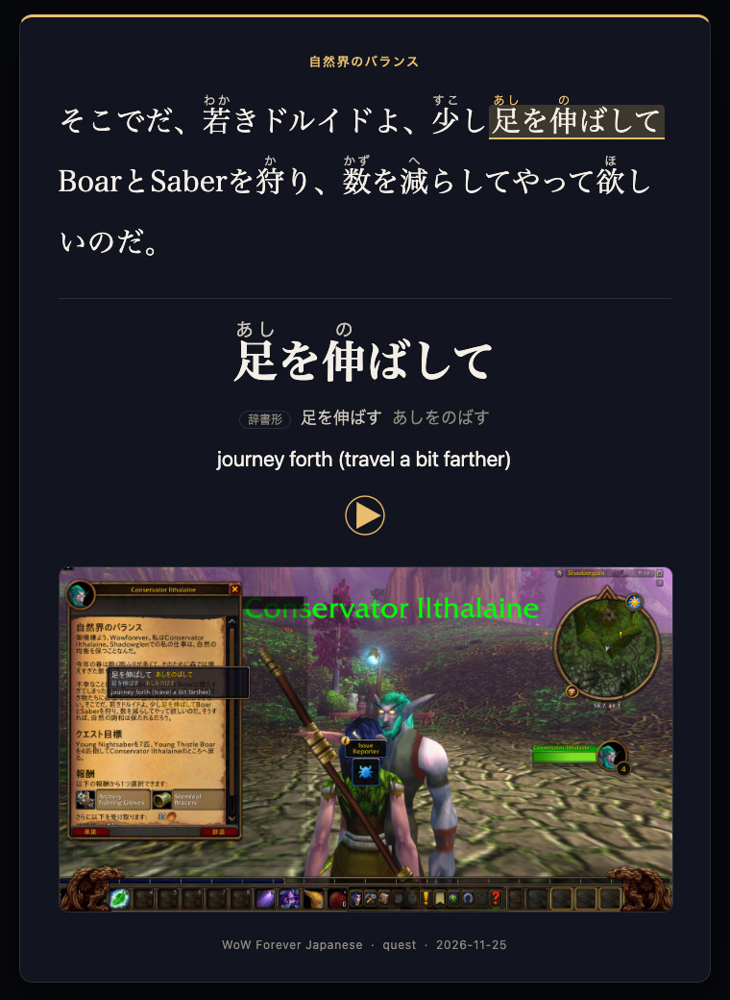
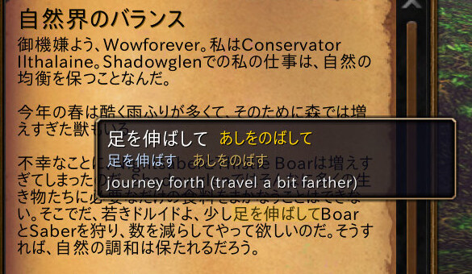

# AnkiWeb listing

The text of the Anki add-on's page on AnkiWeb, where Anki users find it and where Anki checks for its updates.
When the README's Anki paragraph changes, change this too. Paste everything under "Description" into the
listing's description box (it takes Markdown). The pictures are read from this repository's `docs/images/`
on the main branch.

- **Listing:** https://ankiweb.net/shared/info/612475471 (code `612475471`)
- **Title:** WoW Forever Japanese
- **Tags:** `japanese vocabulary games gaming wow forever`
- **Support page:** `https://foreverjapanese.com/discord`
- **Branch:** supports `23.10.1` to the newest Anki the tests ran on, with no `-` in front (a plain maximum
  never blocks a newer Anki). The file is `WoWForeverJapanese.ankiaddon` from `make anki-package`, or from
  the GitHub release.

At each release, upload the new file to the listing by hand: Anki offers it to players within a day.

## Description

**日本語の説明は下にあります。**

## Your World of Warcraft words, as finished Anki cards

Play World of Warcraft in Japanese, click a word you want to remember, and it is waiting in Anki as a finished card. Nothing to copy, nothing to fill in.

This is the Anki half of **WoW Forever Japanese**, a free addon that shows the game's quests, NPC talk, tooltips and menus in Japanese and reads them aloud. You need both: the game addon saves the words, this add-on turns them into cards.

- **Website:** https://foreverjapanese.com (screenshots and a short guide)
- **Discord:** https://foreverjapanese.com/discord (help, bug reports and chat, in English or Japanese)
- **Game addon on CurseForge:** https://www.curseforge.com/wow/addons/wow-forever-japanese
- **Voice packs:** https://www.curseforge.com/wow/addons/wow-forever-japanese-voice

### What is on every card

- **The word**, with its reading and its dictionary form.
- **The sentence it came from**, with the word marked and furigana on the back.
- **A short meaning**, written for the way that sentence uses the word.
- **Your screenshot** of the moment you saved it.
- **The sentence spoken aloud** in the voice of the NPC who said it, when you have the voice packs.
- **Where it came from:** the quest, the game version and the date.

Studying English instead? Words saved from the English side come through too, English on the front and Japanese on the back.

### How it works

1. In game, point at a word and use your save click. The word goes to your word list.
2. Log out or type `/reload`.
3. Switch to Anki. The new cards are already in the **WoW Forever Japanese** deck.

### Getting started

1. Install the game addon from https://foreverjapanese.com and save a word or two.
2. Install this add-on with the code at the bottom of this page, then restart Anki.
3. That is all. It finds your World of Warcraft folder by itself. If it cannot, pick the folder in **Tools → WoW Forever Japanese → Settings**.

### Make the cards yours

- **Front of the card:** the whole sentence with the word marked, or the word alone.
- **Audio:** with the answer, or with the question too.
- **Light and dark**, on the computer and on your phone.
- Change the card's template or styling by hand and your version is kept.

### It leaves your collection alone

- It writes only its own note type and the notes it made. No other note, deck or card is touched.
- Your schedule and review history are never changed.
- A field you edit by hand keeps your edit.
- A card you delete stays deleted, until you ask for it back.
- It only reads your game folder, and it never goes online.

### Before your first sync

The first run adds a note type, so Anki will ask for a one-way sync with AnkiWeb. Sync all your devices first, then choose **Upload to AnkiWeb** on the computer.

### Compatibility

- **Anki:** 23.10 or later, on the computer. Your cards reach AnkiMobile and AnkiDroid through your normal sync.
- **Game:** World of Warcraft: Forever, with the WoW Forever Japanese addon.
- **Audio** needs the addon's free voice packs. Without them the cards simply have no sound.

### Help and source

Something not working, or an idea? Come to the [Discord](https://foreverjapanese.com/discord) or open an issue on [GitHub](https://github.com/zyaga/wow-forever-japanese/issues). The add-on is free and open source (GPL-2.0-or-later). The source is in the same repository as the game addon.

### Support the project

WoW Forever Japanese is free and always will be. If it helps your study and you would like to help it along:

---

## World of Warcraft で保存した単語が、そのまま Anki のカードに

World of Warcraft を日本語で遊び、覚えたい単語をクリックするだけ。Anki を開くと、完成したカードが届いています。コピーも入力もいりません。

これは **WoW Forever Japanese** の Anki 側です。WoW Forever Japanese は、クエスト、NPC の会話、ツールチップ、メニューを日本語で表示し、音声で読み上げる無料のアドオンです。両方が必要です。ゲームのアドオンが単語を保存し、このアドオンがカードにします。

- **ウェブサイト:** https://foreverjapanese.com （スクリーンショットと短いガイド）
- **Discord:** https://foreverjapanese.com/discord （質問、バグ報告、雑談。日本語でも英語でもどうぞ）
- **ゲームのアドオン（CurseForge）:** https://www.curseforge.com/wow/addons/wow-forever-japanese
- **音声パック:** https://www.curseforge.com/wow/addons/wow-forever-japanese-voice

### カードに入るもの

- **単語**と、その読み、辞書形。
- **元の文**。単語に印が付き、裏面にはふりがなが付きます。
- **短い意味**。その文での使われ方に合わせて書かれています。
- 保存した瞬間の**スクリーンショット**。
- 音声パックがあれば、その NPC の声で読まれる**文の音声**。
- **出どころ:** クエスト、ゲームのバージョン、日付。

英語を勉強している方へ。英語側で保存した単語もカードになります。表が英語、裏が日本語です。

### 使い方

1. ゲーム内で単語にマウスを合わせ、保存クリックをします。単語が単語リストに入ります。
2. ログアウトするか、`/reload` と入力します。
3. Anki に切り替えます。新しいカードはもう **WoW Forever Japanese** デッキに入っています。

### はじめかた

1. https://foreverjapanese.com からゲームのアドオンを入れ、単語をいくつか保存します。
2. このページの下にあるコードでこのアドオンを入れ、Anki を再起動します。
3. これだけです。World of Warcraft のフォルダは自動で見つかります。見つからないときは **ツール → WoW Forever Japanese → 設定** でフォルダを選んでください。

### カードを自分好みに

- **カードの表:** 単語に印を付けた文全体、または単語だけ。
- **音声:** 答えを見たとき、または問題のときにも。
- **ライトとダーク**に対応。パソコンでもスマートフォンでも。
- テンプレートやスタイルを自分で変えた場合は、その内容が残ります。

### あなたのコレクションには触れません

- 書き込むのは、このアドオンのノートタイプと、このアドオンが作ったノートだけです。ほかのノート、デッキ、カードには触れません。
- 学習スケジュールと復習履歴は変わりません。
- 手で編集したフィールドは、その内容が残ります。
- 削除したカードは、戻すよう指示するまで削除されたままです。
- ゲームのフォルダは読み取るだけです。通信は一切行いません。

### 最初の同期の前に

最初の実行でノートタイプが追加されるため、Anki は AnkiWeb との一方向の同期を求めます。先にすべての端末を同期してから、パソコンで **AnkiWeb にアップロード** を選んでください。

### 対応環境

- **Anki:** パソコン版 23.10 以降。カードはいつもの同期で AnkiMobile と AnkiDroid にも届きます。
- **ゲーム:** World of Warcraft: Forever と、WoW Forever Japanese アドオン。
- **音声**には無料の音声パックが必要です。なくてもカードは作られ、音が付かないだけです。

### サポートとソース

うまく動かないときや、アイデアがあるときは、[Discord](https://foreverjapanese.com/discord) か [GitHub](https://github.com/zyaga/wow-forever-japanese/issues) へどうぞ。このアドオンは無料のオープンソースです（GPL-2.0-or-later）。ソースはゲームのアドオンと同じリポジトリにあります。

### プロジェクトを応援する

WoW Forever Japanese は無料で、これからも無料です。学習の役に立ち、応援したいと思っていただけたら:

