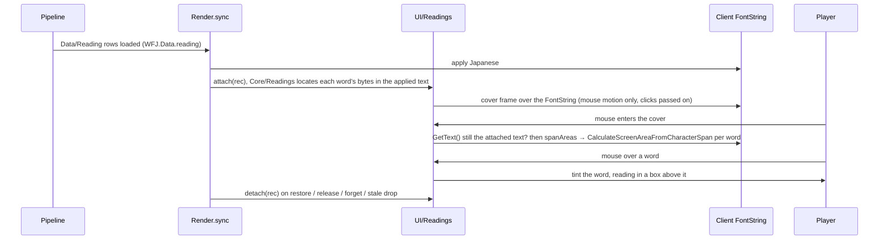

# Readings

> The word-reading box: pointing at a Japanese word in quest or gossip prose, in a plain-text window label, on a plain-text book or letter page, on a [frozen tooltip](#tooltip-text-and-the-frozen-tooltip), or on a [chat line](#chat-lines) shows that word's whole reading (少し → すこし) in a small box above it. Where the word carries a dictionary form and a meaning, the box is the **word card**. Code: `pipeline/wfj/core/readings.py`, `pipeline/wfj/cmd/readings.py`, `pipeline/wfj/core/glosses.py`, `pipeline/wfj/cmd/glosses.py`, `validate` rule 8, `generate`'s `Data/Reading/` and `Data/Gloss/` files, `Core/Readings.lua`, `Core/Glosses.lua`, `UI/Readings.lua`, `UI/ReadingPopup.lua`, `UI/TooltipFreeze.lua`, `UI/WordMarks.lua` ([word status marks](#word-status-marks)), the `Render` attach / detach calls, the `readings.enabled` and `readings.glosses` settings. In English first the same box is the **English word card**, on the English the client shows ([below](#english-word-cards)). Decisions: [ADR-036](../adr/036-readings-hover-word-lists.md), [ADR-039](../adr/039-word-meanings-written-in-context.md), [ADR-041](../adr/041-word-cards-on-window-labels.md), [ADR-044](../adr/044-area-text-and-book-word-cards.md), [ADR-081](../adr/081-english-first-and-english-word-cards.md), [ADR-108](../adr/108-the-frozen-tooltip-and-word-cards-on-tooltip-text.md), [ADR-109](../adr/109-chat-tools.md). The box and the card are among the few on-screen additions [principle 3](../architecture/principles.md#3-japanese-by-default-english-one-key-away) allows.

## Purpose
A learner can read a kanji word without anything being added to the text until they ask for it. Nothing is drawn until the mouse is on a word; the Japanese box never shows while English shows; one setting turns it off. Readings are their own data, keyed to the Japanese they annotate, so a translation and its readings change independently.

A word can also carry its dictionary form and a short English meaning of the whole word as the sentence uses it (食べている → 食べる, "is eating"). Such a word shows the **word card** instead of the reading-only box. The meaning is written by the model with the sentence in front of it, so it is the sense that sentence uses, not a dictionary list.

A highlighted word can be kept: the **save click** (Ctrl+click by default) adds it to the player's word list. How the click is read is below ([Saving a word](#saving-a-word)); the list itself is [Word list](word-list.md).

## How it works


### Data
`data/reading/<type>/<type>-NNNN.jsonl`, types `quest` (every quest field), `gossip` (`text`), `ui` (`text`; keyed by the UI string key, `data/reading/ui/ui-<first character>.jsonl`) `book` (`text`; keyed by the page id, like the book translation store), `item` (`description`) and `spell` (`description`, `aura`), the same sharding as the translation store. One record per shipped Japanese line:

```json
{"id": 456, "field": "title", "ja_hash": "90029072567103f2", "words": [["自然界", "しぜんかい"]], "provenance": {"class": "machine", "model": "<model id>", "source": "readings@<batch>", "imported": "2026-09-25"}}
```

- `words`: entries in reading order, each `[word, whole reading]` or `[word, whole reading, dictionary form, its reading, meaning]`, e.g. `["倒して", "たおして", "倒す", "たおす", "defeat"]`. Every word must sit in the Japanese after the previous one, hold **no ASCII character** (names stay English, [principle 2](../architecture/principles.md#2-names-stay-in-english); and the generated row packs words with ` ` and `=`), and carry a kana-only reading (hiragana, katakana, ー). A word holds a kanji, or is a **kana word**: all kana, its reading is itself, and only as a 5-item entry (it is listed for the card only). The Japanese itself is never copied or changed.
- The 5-item entry: **one word = the whole inflected unit**: a verb or adjective with all its endings and helper verbs (減らしてやって欲しい → 減らす, "I want you to reduce (them) for me"), noun + する, a noun with a plural or honorific suffix, a fixed expression; a noun and its particle are never one word. The dictionary form keeps the text's spelling (a word written in kana stays in kana: いる, not 居る) and holds no ASCII; its reading is kana. The meaning is one trimmed line of at most 60 characters with no `|`, tab or line break. A 3- or 4-item entry is refused. Every batch writes 5-item entries.
- `ja_hash`: the addon's hash primitive over the Japanese exactly as stored. A reading whose Japanese has changed since is **stale**: `validate` prints it (not a failure), `generate` leaves it out.
- `provenance.class`: `machine` (needs `model`; source `readings@<batch>`) or `correction` (a reviewed fix: `translator` = who wrote the fixed reading, source `correction@<date>`, `corrects` = the source it replaces, optional `note`). Machine output never replaces a correction.
- **Book pages.** Stored by page id; shipped under the key the addon finds a page by, its English hash (`readings.addon_keyed`, below). A page written as HTML (`<HTML`, `readings.html_page`) is never exported and never owed a reading: it keeps the client's SimpleHTML, which cannot place a card. Objective and area text take no readings. Item and spell text does, shown on a frozen tooltip ([below](#tooltip-text-and-the-frozen-tooltip)).
- A record whose line no longer ships (rejected, withdrawn) is stale too: reported, left out, back when the line ships again with the same Japanese. A malformed record or a duplicate `(id, field)` fails `validate` and `generate`.

Full shape: [Data model](../architecture/data-model.md).

### Pipeline
| step | command | what |
|---|---|---|
| export | `wfj readings export --type quest\|gossip\|ui\|book\|item\|spell --ids FILE [--all] [--class machine\|human\|correction] --out BATCH.jsonl` | one row `{type, id, field, ja, ja_hash, en}` per shipped Japanese line of those ids with no current reading (`--all`: every line). `--class` keeps only lines whose shipped variant has that provenance class (`--class machine`: the machine-written lines). A line holding a `|` escape sequence (a colour code, `|n`) is left out: the reading box refuses it. A line with nothing to annotate is left out too: the Japanese needs a kanji, or a run of kana that is more than a bare particle or copula (は が を に で と の へ も や か よ ね な から まで だ です ー; `readings.annotatable`), so an English-only title, or names joined by a particle ("TyrandeとRemulos", "%sの%s"), is not exported; `en` is the line's current English from `data/english/<type>/`, left out when there is none; batch input only, the import ignores it and it never ships. ui ids are UI string keys, one per line; book ids are page ids, and an HTML page is never exported |
| words | the drafting model | writes 5-item `words` onto each row (following [Translation batches → Readings for a batch](../operations/translation-batches.md#readings-for-a-batch); the meaning uses the game's word from `en` where the Japanese word translates it), or, for a new translation, on the draft row itself (below) |
| import | `wfj readings import BATCH --model M --batch NAME [--date D] [--dry-run]` | rejects each bad row with its reason (shape, not found in order, no kanji (or a kana word that is not a 5-item entry reading itself), ASCII, non-kana reading, a bad dictionary form or meaning, Japanese changed since export, no shipped line, twice in the batch, an empty `words` list) and writes the rest; a `correction` reading is kept and reported. When it wrote an item or spell row, it then runs `spread` (below) |
| export tooltips | `wfj readings export-tooltips --out BATCH.jsonl [--all]` | one row for each tooltip **sentence** nobody has written yet, across the item and spell lines with no current reading (`--all`: every sentence of every line). The row is `{type: "piece", id, field: "text", ja, ja_hash, line, en?}`: `ja` is the sentence, `line` the first line that holds it, `en` that whole line's English for context. A line holding an escape sequence is left out and listed with its reason; a sentence with nothing to annotate is left out silently |
| import tooltips | `wfj readings import-tooltips BATCH.jsonl --model MODEL --batch NAME [--date D] [--dry-run]` | the sentence rows with `words`. Each row is checked against its own sentence; a bad row is rejected with its reason and its lines wait. Then every line whose sentences are all written is built and gets a record |
| spread | `wfj readings spread [--dry-run]` | every item and spell line with no current reading of its own that is made of sentences already written gets its record: a new item, a changed line, another rank of a spell. A line with a current reading of its own (a correction among them) is left alone. `make tooltip-words` runs it and lists the sentences still to draft; `make import-draft` and `make report-apply` run that target |
| correct | `wfj readings import BATCH --correction --by NAME [--date D] [--note TEXT] [--dry-run]` | the rows fix readings already in the store: each is written as a `correction` record; a row for a line with no reading yet is rejected, `no reading to correct` |
| validate | `wfj validate`, rule 8 | re-checks every record against the shipped Japanese; prints stale readings, how many lines per type (quest, gossip, ui, book, item, spell) have one, and the lines owed one (something to annotate, by the export's rule above, and no current reading), up to 20; lines holding `\|` counted apart, not owed; `validate: readings: N of M words carry a meaning (the word popup)`; `validate: readings: N <type> words have no meaning` per type while any current word lacks one. Rule 5 (regenerate-and-diff) also fails when `data/reading/meaning-numbers.tsv` is not the file `generate` would write: missing, some meanings with no number, or any other difference; `validate` never writes it |
| generate | `wfj generate` | `Data/Reading/Reading_<type>_<shard>.lua` (ui shards: the UI dictionary's, the key's first character): `["<type>:<id>"] = { <field> = "word=reading word=reading=n …" }` (`=n`: the word's meaning number); a book row is keyed `["book:<16-hex English hash>"]` in `Reading_book_<hh>.lua` (`readings.addon_keyed`: pages sharing one English ship the lowest page id's reading, the page whose Japanese `lua_writer.keyed_rows` ships; a stale page gives way to a current one); then `Data/Gloss/Gloss_<NNNN>.lua` (below); readings load after the translation types, meanings after the readings; `Meta.counts.reading` = lines with a current reading, `Meta.counts.gloss` = distinct meanings shipped. Writes `data/reading/meaning-numbers.tsv` when it numbered a new meaning and prints `generate: N meanings numbered for the first time` |
| check meanings | `wfj glosses check --jmdict FILE [--readings DIR] [--top N]` | **local only**: words with a meaning, distinct meanings, and the dictionary forms JMdict (jmdict-simplified English JSON) does not know, most used first: usually game compounds, but a misspelt or invented form shows up there too. No JMdict data is committed or shipped |

**One packed string per field.** A Lua string per word and per reading cost more than the Japanese itself, in file size and in client memory. On disk `Data/Reading/` is about 1.8× the size of the four folders it annotates (`Data/Quest`, `Data/Gossip`, `Data/UI`, `Data/Book`). Runbook: [Translation batches → Readings for a batch](../operations/translation-batches.md#readings-for-a-batch).

**The meaning table.** `generate` collects every distinct `(dictionary form, its reading, meaning)` from the current readings and writes them 1,000 per file: `Data/Gloss/Gloss_<NNNN>.lua` = `WFJ.Data.add("gloss", { [n] = "dictionary form<TAB>its reading<TAB>meaning" })`. A reading row points at a meaning by number (`word=reading=n`), so a meaning used by many lines is stored once. A stale reading's meanings are not emitted.

**Meaning numbers are stable** ([ADR-060](../adr/060-stable-meaning-numbers.md)). The numbers live in a committed file, `data/reading/meaning-numbers.tsv`: one line per meaning ever numbered, `n<TAB>dictionary form<TAB>its reading<TAB>meaning`, sorted by `n`. It is generated (marked `linguist-generated`); never edit it by hand.

- A meaning keeps its number from one run to the next, so adding a meaning changes only the Reading files that use it, the last Gloss file and the meaning count in `Data/Meta.lua`.
- A new meaning takes the next number after the highest in the file. Several new ones are numbered in sorted order, so a run is deterministic.
- A meaning no current reading uses keeps its line and ships nowhere: its number is a gap in `Data/Gloss/`. The gloss table is read by number only, so a gap is harmless.
- A number is never given to another meaning. A meaning that comes back gets its old number.
- With no file, the meanings are numbered 1 to N in sorted order, and `generate` writes the file.
- A malformed line, a number given twice or a meaning listed twice stops `generate` with an error naming the file.

`Core/Glosses.lua` and the Lua row formats do not depend on how the numbers were chosen.

**Readings in the draft row.** A quest, gossip, UI, book, item or spell translation batch writes its readings with its Japanese: the drafting model adds `words` to each draft row, `translate_lint` checks them with the import's rules (a line with something to annotate and no `words` passes with a warning, as its readings are still owed; lint uses validate's rule, `readings.annotatable`, so a kana-only line like はい。 owes its words too), and `translate_batch expand` writes `<name>.words.jsonl` for `wfj readings import` once the lines are imported. Export → words → import remains for lines that got Japanese without words.

Verbs in full: [Pipeline](pipeline.md).

### Display
- **`Core/Readings.lua`** (pure). `words(kind, id)` parses the packed row (`kind` = `quest.<field>`, `gossip`, `ui` → `ui:<KEY>`'s `text`, `book` → `book:<English hash>`'s `text`, or `item.description`, `spell.description`, `spell.aura` → `item:<id>` / `spell:<id>`); `locate(words, text)` finds each word's first and last byte in the text on screen, in order, each search starting after the previous word. A word the text does not hold (a substituted `{name}`, a changed line) is skipped; the rest are still found.
- **`Core/Readings.lua`, meanings.** `words` returns triples `word, reading, gloss` (the meaning number, or `false`); `locate`'s spans carry `word`, `reading` and `gloss`. `withTokenWords(spans, text)` adds a span for every class and race word in the text on screen: the katakana the addon fills in for `{class}` / `{race}` (read from `Core/Placeholders`' `CLASS` / `RACE` on first use; `Readings.tokenWords()`), which no reading row can list, and the same katakana words in prose, when the word stands alone (no katakana or ー directly before or after it: トロール in コントロール / パトロール, オーク in オークション, ハンター in シャドウハンター get nothing) and no listed word already covers that spot. 人間 (Human) is left out: in prose it is the common noun "person". Their card carries the English name ("Druid (a class)"; names stay English). `tokenSpans(text)` returns those same standing-alone class / race words, and `lookup` passes them to `locate` as guards: a listed word found on part of one, inside it (エルフ inside a filled-in ナイトエルフ) or across its edge, is passed over and the search goes on, so it anchors on its own word in the prose; a word covering the whole class / race word (ドルイド, ウォリアーたち) is kept. Every standing-alone class / race word is a guard, filled-in or written in prose: a word list must not split a prose ナイトエルフ into ナイト + エルフ (none does; checked over every current row).
- **Name cards** ([ADR-106](../adr/106-names-shown-in-japanese-on-screen.md)). With Japanese names on (`names.japanese`), a name the addon wrote in Japanese on a word-card surface gets a span of its own. The policy layer's names step returns the names it replaced (`{ ja, english, reading }` in text order) on the payload, and `Readings.withNames(spans, text, names)` adds a span for each one found in the text on screen, marked `name = true`, whose card holds the name's reading and the English the client wrote (held in memory with the record, never shipped). A name in a window label takes one the same way, and so does a name on a [frozen tooltip](#tooltip-text-and-the-frozen-tooltip). The card is the word card's box and follows its settings. A name is never saved to the word list (the save click passes over a `name` span) and its card carries no save hint.
- **`Core/Glosses.lua`** (pure). `Glosses.get(n)` → `{ lemma, lemmaReading, meaning }` from `WFJ.Data.gloss[n]`, or nil.
- **`UI/Readings.lua`** (`WFJ.ReadingView`). `Render.sync` calls `attach(rec)` after it applies Japanese, and `detach(rec)` before every restore, release, forget and stale drop. `attach` takes records on `SURFACES` and window labels (below), lays one **cover frame** over the FontString (`SetAllPoints`, mouse motion enabled and propagated; its own clicks off with `SetMouseClickEnabled(false)` and passed on with `SetPropagateMouseClicks(true)`) and remembers the exact applied text and the word spans. A frame with mouse motion is where the client sends a click unless the frame passes clicks on, so without the two click calls a cover over a translated placeholder took the click meant for the box under it (the auction house's search box, and the bags', the quest log's, the spellbook's and the other search and edit boxes whose placeholder the addon translates). A cover is never made in combat: `SetPropagateMouseMotion` is a protected call the client blocks there, so a line first shown in combat gets its cover the next time it is attached. A caller that has already located the words passes them in `rec.spans` (optional; `attach` then skips its own `Readings.lookup`). The voice panel needs this: a line's word list is in the order of the whole line, so one sentence looked up alone can match an earlier sentence's word late and miss its own. `UI/VoicePanelText` locates the words once in the whole line and gives each page its share, shifted to the page.
- **A mark for a caller.** `View.spanAreas(fs, text, first, last, where)` is public: the study card measures the tested word's rectangles with it and draws its own gold tint over them ([Study → The card](study.md#the-card)). The chat cards measure the word under the mouse with `View.chatSpanAreas(line, text, first, last)` and draw it with `View.showHover` on a cover of their own ([below](#chat-lines)); the cover itself draws nothing but the hover tint.
- **Following the FontString:** `QuestInfo_Display` moves its FontStrings between the quest window's panels, the quest map details pane and its popup; `attach` re-parents the cover to the FontString's current parent each time. A re-attach while the mouse rests on the text starts the hover again (no new `OnEnter` would come). `Render` attaches only once the bundled font is applied (a refused font lays the text out in another face); `Render.retryFonts` attaches when the retry succeeds.
- **On mouse enter** the cover checks that the FontString is visible and still shows exactly the text it was attached for (gossip rows are pooled and can be rewritten outside `Render`); otherwise it hides itself and does nothing, so a missed detach can never show a wrong reading or keep taking mouse motion. It then measures every word's rectangles fresh, so layout, resize and scroll are always current. While the mouse is inside, an `OnUpdate` maps the cursor (divided by the effective scale) to a word rectangle.
- **On a word:** a gold tint at low alpha over each of the word's rectangles (one per line, so a word wrapped onto the next line tints both parts) and a box with the reading in white (the game's own tooltip frame and border (`TooltipBackdropTemplate`), sized to the text plus 18 × 12 px for the border; strata `TOOLTIP`), in the bundled font at the text's size (at least 12), 2 px above the word's first rectangle. Off every word, both hide. The box and the card live under `View.host(anchor)`: `UIParent`, unless the text sits in a window drawn outside it, whose top frame they move under instead (`View.reparent`, strata `TOOLTIP` either way). Dialogue UI draws its windows with no parent and fades `UIParent` out while they show, so a box under `UIParent` would fade with it ([ADR-073](../adr/073-dialogue-ui-windows-get-our-japanese.md)).
- **The word card (`UI/ReadingPopup.lua`, `WFJ.ReadingPopup`).** When the hovered word carries a meaning (`Glosses.get`, or a class / race word's own card) and `readings.glosses` is on, `UI/Readings` shows the card instead of the box, at the same anchor (bottom-centre, 2 px above the word) and strata:

  ```
  倒して  たおして              the word (text size + 2, at least 14) and its reading (a kana word shows once)
  倒す　たおす                  the dictionary form and its reading (pale blue / muted gold), only when it differs
  defeat (and then)            the meaning in this sentence, wrapped inside the card
  ```
  280 px wide (`Popup.WIDTH`), clamped to the screen; drawn on `TooltipBackdropTemplate`, the game's tooltip frame and border, with 10 px padding inside it. It owns no data and no hit testing; `UI/Readings` shows and hides it. `Popup.show`'s optional last argument is a **hint**: one grey line (11 pt) under the meaning. `UI/Readings` passes `View.hint()` (`WordSave.hint()`), which names the save click in both languages, `Ctrl+click: save word ・ Ctrl+clickで単語を保存`, until the player has saved a word once (`WFJ_Words.everSaved`, kept through Clear all), and nothing while the save click is `off`. The reading-only box takes no hint. A kanji word with no meaning, or any kanji word while `readings.glosses` is off, shows the reading-only box. A kana word is listed for the card only: without a meaning, or with meanings off, it is not a hover target (`measure` skips it).

| surface (`SURFACES`) | where |
|---|---|
| `questframe.detail` · `questframe.reward` · `questframe.progress` | the quest window's panels |
| `questframe.greeting` | the quest greeting prose |
| `questmap.info` · `questmap.popup.info` | the quest map's details pane and its popup |
| `gossip` (record key `greeting` only) | the gossip window's greeting; option rows are buttons and get none |
| `itemtext` | a plain-text book / letter / plaque page showing Japanese (below); an HTML page gets none |
| `voicepanel` (record keys `text` and `full`) | the voice panel's sentence and its whole-text window ([Voice over](voice.md#the-voice-panel-uivoicepanellua)); the panel's English view (reveal key held) takes none |
| `dialogueui.detail` · `dialogueui.progress` · `dialogueui.reward` · `dialogueui.greeting` · `dialogueui.gossip` · `dialogueui.book` | Dialogue UI's quest, NPC talk and book windows, when that addon is installed ([ADR-073](../adr/073-dialogue-ui-windows-get-our-japanese.md)). Dialogue UI splits a line into paragraphs and lays each out in its own FontString, so `UI/DialogueUI` and `UI/DialogueUIBook` give each paragraph a record of its own (record key `<field>.<n>`, or `page<N>.<n>` for a book block) with its share of the line's words in `rec.spans`, as the voice panel does. Option rows, objective lines and HTML book pages get none |
| `dialogueui.title` | the quest title in Dialogue UI's page header (one record, as the quest window's title), with the titles switch on: an English title has no word cards. Its buttons and section headings get none: a heading may be the addon's own word (Requirements → 必要なもの), which has no reading data, so the game-word headings beside it take none either |
| `tooltip.frozen` (`View.COPIES`) | the frozen tooltip's copy ([below](#tooltip-text-and-the-frozen-tooltip)): each line passes its own `rec.spans` and the kind and id of the line it copies, so it takes cards whatever its kind, a window word among them |
| `study` (record key `sentence`) | the study card's sentence ([Study](study.md#the-card)): the card passes its own `rec.spans` (the sentence's words from the line's reading list, minus the tested word, whose reading is the answer); the card draws the mark over the tested word itself, through `View.spanAreas` |

Chat lines are a word-card surface too, but not through a cover: `UI/ChatCards` finds the word itself ([below](#chat-lines)).

Forever has no trainer greeting window; a trainer's greeting is a gossip greeting.

### Saving a word
A highlighted word is saved to the [word list](word-list.md) with the save click (`words.saveClick`: Ctrl+click by default; [ADR-069](../adr/069-saved-word-list.md)). The cover does not take the click. A click-enabled cover would stand between the player and the window under the text, so the click is read by **polling** instead, in the `OnUpdate` that already runs while the mouse is over the cover (`View.poll`):

- each frame it reads `IsMouseButtonDown("LeftButton")` (resolved once); a press remembers the hovered word (`cover.pressWord`), and a release on the **same** word saves it when the modifiers held at the release match the setting (`Words.matches` in `UI/WordSave`: Ctrl only, Shift only, Cmd only, or none of the three for a plain click; read from `IsControlKeyDown`, `IsShiftKeyDown`, `IsMetaKeyDown`);
- `OnEnter` records whether the button was already down, so the end of a drag that started elsewhere is not a click; a press off every word, a release on another word or off the cover, or other modifiers save nothing; one press saves at most once;
- with the setting `off` the poll returns at once (`WordSave.choice()`, kept current from State `saveClick`), unless the cover is on a place with word status marks on: then the poll keeps running for the status clicks ([Word status marks](#word-status-marks)).

`UI/Readings` only reads the click: on a release over the pressed word it calls `WordSave.release(cover, word)`. **`UI/WordSave`** checks the modifiers and saves. `measure` keeps each word's byte span (`first`, `last`) in the applied text, and `attach` keeps the record's `kind`, `id` and `surface` on the cover; `WordSave.save` hands those, the word, its reading and its meaning (`Glosses.get`, or a class / race word's own card, whether or not meanings are shown) and, for quest text, the shipped Japanese quest title to `Words.add`. A new entry flashes the tint brighter for a quarter second (`View.flash`) and prints `Saved <word> (N words)`; a word already saved prints `Already saved: <word>`; a list a newer addon version wrote prints that it cannot be changed. Each chat line holds both languages. With `words.screenshot` on, the card (or box) hides (`View.hideCard`), the tint stays, `Screenshot()` runs, and the chat line and the card (`View.reshow`) come back on `SCREENSHOT_SUCCEEDED` or `SCREENSHOT_FAILED` ([Word list → Screenshots](word-list.md#screenshots)). Nothing in the save path is a protected call, so it works in combat.

Because the cover takes no click of its own and passes every click on, every click, drag and wheel scroll over covered text reaches the same frame as before, whatever the setting. On the voice panel the click also reaches the panel itself, as any click there does. A press and release inside one frame is missed (the poll sees no press).

### Word status marks
A cover on a place with word status marks on also carries them ([Word status](word-status.md), [ADR-111](../adr/111-word-status-marks-frequency-and-score.md)): a red or blue underline by the word's status, a soft green highlight on the Unknown words the highlight setting picks, and a score tag over the text's top right corner. `UI/Readings` owns the cover and calls out to `UI/WordMarks`, which draws:

- `lay` calls `WordMarks.laid(cover, rec, english)`, and `View.detach` calls `WordMarks.clear(cover)`; the cover's `OnShow` and `OnSizeChanged` call `WordMarks.moved`, and `onEnter` calls `WordMarks.arrived` and `WordMarks.entered` with the words it just measured. `View.setEnabled` redraws every marked cover.
- `View.measure` is shared: the marks are drawn under each word from the same rectangles the hover uses, so every span still goes through [the guard](#the-guard).
- `View.poll` hands a click with Shift held to `UI/WordMarks` first: a Shift+click steps the word's status and a Shift+right-click ignores it (`WordMarks.pollRight` reads the right button the same way). A status click is not also a save. With the save click set to Shift+click the status clicks are off, and with marks off or no Shift held the poll does what it did before.
- `showHover` puts the card's status line (the status, the word's rank, **Common** for a word to learn next, and the click hint) above the save hint, through `WordMarks.statusLine`. A word with no key, or a place that is off, shows the card as before.

**Book pages ([ADR-044](../adr/044-area-text-and-book-word-cards.md)).** The client draws a page in a SimpleHTML (`ItemTextPageText`), which has no span call [verified: Forever 1.60.1.70009 `SimpleHTMLAPIDocumentation`: `GetTextData` gives `{ text, type, align }` only]. So `UI/ItemText` draws a plain-text page showing Japanese in a FontString of its own, laid where the SimpleHTML's text starts, as wide as it, in the `P` text type's font and colour, and gives the SimpleHTML `""` while it shows (details: [Addon modules → ItemText](../architecture/addon-modules.md)). The page record's `fs` is the ItemText page adapter; `page:spanRegion()` returns the adapter's FontString, and `UI/Readings` (`region(rec)`) covers it only while it holds exactly the text the record applied; a page drawn by the SimpleHTML (English, an HTML page) takes no cover. A page turn or a new item hides the FontString; the cover's text check on enter then hides the cover too.

**Window labels ([ADR-041](../adr/041-word-cards-on-window-labels.md)).** A `ui` record (a label shown by `UI/Labels` → `Render.show(…, "ui", "ui", key, …)`) takes a cover on **any** surface when all hold:

| check | refuses |
|---|---|
| the widget has `CalculateScreenAreaFromCharacterSpan` | a Button's text (a ButtonText adapter) and a menu entry (a `Labels.menuText` adapter): buttons, tabs, menus, dropdowns |
| the FontString's parent is not a Button (`IsObjectType("Button")`) and not protected (`IsProtected()`): `inWindow` | CheckButton and list-row text; anything inside a secure frame |
| the surface is not non-window (`View.nonWindow`) | `View.NON_WINDOW` and every surface under each name (`alerts` → `alerts.<anything>`): alerts, toasts, banners, the tracker, the quest map's tracker headers (`questmap.trackerlabels`) and objectives, HUD labels, the gamepad HUD (`gamepad`), the errors frame, combat text / feedback, the casting bar, unit frames, zone text, chat tabs, queue status, the cooldown viewer, the damage meter, `help` (UI/HelpTooltip, MicroMenu's records on it), the new player tutorial's on-screen prompts (`npe`), and the surfaces whose labels are GameTooltip lines under a name without `tooltip` (`auctionhouse.token`, `communities.benefits.rewardtip`, `deathrecap.tip`, `quickjoin.tip`), …; any surface whose name holds `tooltip` (the frozen tooltip's `tooltip.frozen` is a copy surface, decided before this rule); each surface `UI/TooltipLines.follow` follows (`View.tooltipSurface`: that exact surface only, not the surfaces under its name) |
| `Readings.words("ui", key)` has words found in the applied text | a label with no word list, and a label whose only words would be the class / race token cards (a label holding only ドルイド): those cards are for prose only |

Every other surface is a window: the quest window's 報酬 and 以下の報酬から1つ選択できます, the character sheet's labels, the spellbook, mail's 宛先:. The prose rule above is unchanged. A cover is a frame of the addon's with no field of its own (its state is in the addon's own table), and in a Blizzard layout frame (`IsLayoutFrame`) it is parented one level up and follows the label's show and hide, so the client's layout code never counts or reads it ([Principles → 10](../architecture/principles.md)).

Two pytests keep the list honest: every `NON_WINDOW` entry names a surface some UI module registers, and `test_every_registered_surface_is_classified` resolves every surface name a module hands to `Labels` / `LabelTree` / the Communities kit / `Render` / `TooltipLines` (literal, constant or the `show` alias) and fails on one that is neither in its `WINDOW_SURFACES` set nor non-window; `test_no_new_surface_named_by_a_variable` pins the reviewed call sites that pass a variable: a new surface is a window only once someone has decided so.

**Known limit: composite labels.** In a label built from a pattern and filled-in arguments (`Labels.showArgs`, a popup with filled args), the word search runs over the whole line on screen. A listed word that also appears inside an argument filled in earlier in the line (a name, an item) is found there first. The reading is still right for those characters; only the spot is not the pattern's own word.

### English word cards
In English first (`direction = en`, [Settings](settings.md#the-direction-and-the-language-on-screen)) the client's English stays on screen, and pointing at an English word shows a card for it ([ADR-081](../adr/081-english-first-and-english-word-cards.md)). It is the mirror of the Japanese card, for a Japanese player studying English: the same cover, the same box, the same two settings, the same save click.

```
defeat  /diˈfiːt/            the English word as the line writes it, and how it is said
倒して　たおして              the Japanese word the shipped translation uses for it in this line, with its reading
辞書形：倒す（たおす）         that word's dictionary form, only when it differs
```

- **How they attach.** When English is what shows, `Core/Translator` answers `"leave", { english = true }`. `Render.sync` restores the client's text as always and, while the direction is `en`, calls `View.attachEnglish(rec)`. That lays the ordinary cover over the FontString the client drew the line in (or, for a book page, over the page's own FontString, below), with spans from `Readings.englishLookup(kind, id, text)`. Holding the key in Japanese first shows the English with no cards, as before. With the key held in English first the line is our Japanese and takes the Japanese cards.
- **Where.** The same rule as the Japanese cards (`takesCards`): the prose surfaces of the client's quest window, quest greeting, quest map and gossip greeting, plain-text labels in windows, and plain-text book and letter pages. The study card's sentence takes them for an English entry, through `Words.lineSpans` ([Study](study.md#the-card)). Never a button, tab, menu, tooltip, tracker line or the HUD. A frozen tooltip takes none either: English first shows the client's own tooltip, and the copy shows it as it stood, with no cards.
- **The lookup** (`Core/Readings.lua`, pure). A word is a run of ASCII letters and apostrophes in the text on screen, so both ends of a span are always character boundaries. Each word is lower-cased and looked up in the line's own row (`WFJ.Data.english["<type>:<id>"][field]`, packed `word=n word=n …`): `n` is the place of the Japanese word in the same line's reading row, which gives the Japanese word, its reading and its meaning number. A word the row does not list is looked up in the common word list (`WFJ.Data.common`, `Japanese=reading`). A contraction with no card of its own takes its first word's (you're: you; let's: let), over the whole contraction. How the word is said comes from the pronunciation table (`WFJ.Data.pron`); a word without an entry shows the card without that part. A place past the end of the reading row is dropped, never read.
- **The card's lines** (`Popup.englishLines` in `UI/ReadingPopup.lua`): the English word, its pronunciation between slashes, the Japanese word (a size larger than a dictionary-form line, since it is the thing looked for) with its reading when the reading differs, and `辞書形：` with the dictionary form (and its reading in brackets) when the meaning row has one that differs from the Japanese word. `readings.glosses` off shows the reading-only box, which holds the Japanese word and its reading.
- **What gets no card.** A name (names stay English), a code the client fills in, a word the line's Japanese has no word for, and the words left out by design: the articles, the bare forms of be, have and do, and to, of, in, on, at, for, as, by, than, off, upon. Japanese has no word for an article, and the others only mean something with the words around them.
- **Book and letter pages.** The client draws a page in a SimpleHTML, which has no span call. So in English first `UI/ItemText` draws the client's own plain-text page, word for word, in its own FontString, in the page's own font and colour, wrapping at spaces (`page:englishRegion`), and `View.attachEnglish` lays the English cards on that FontString. The adapter hands it over only while the page shows the client's own text.
- **Limits.** A page the client marks up as HTML takes no English cards, the same as for Japanese cards. Neither does a letter a player wrote (it is never translated), nor any page while translation or the books area is off: the SimpleHTML keeps those as the client wrote them. Text holding a `|` escape takes none, as for Japanese ([the guard](#the-guard)). The voice panel's English view takes none, and neither do Dialogue UI's windows: the text there is laid out by that addon, and the English left in them is not ours to measure.
- **The data.** `Data/English/` is generated from the readings and each line's English; no English sentence ships, only the single words that found a Japanese word, per line, sorted. Shape: [Data model](../architecture/data-model.md). How the pairs are made and how many words get a card: [Pipeline](pipeline.md#generate--validate) and [Coverage](../operations/coverage.md).
- **Saving.** The save click on an English word saves an English entry ([Word list](word-list.md#english-entries)).

### Chat lines
Chat is a word-card surface with no cover and no reading rows ([Chat tools](chat-tools.md), [ADR-109](../adr/109-chat-tools.md)). What players type has no shipped line behind it, so `UI/ChatCards` finds the word itself: a timer asks the visible chat line's own FontString which byte is under the mouse (`FindCharacterIndexAtCoordinate`), `Core/ChatWords` cuts the Japanese or English around it into a word from the chat word lists, and `View.chatSpanAreas` gives its rectangles for the gold tint. The card is the word card (`UI/ReadingPopup`), or the reading-only box with `readings.glosses` off, as on every word-card surface. `readings.enabled` off hides it, and `chat.cards` turns chat alone off.

- **Japanese first** shows Japanese words; **English first** shows English words, with the English word card's lines.
- No card while the reveal key is held, with translation off, on a faded line or on a line the client keeps secret. A link's label never takes one.
- The save click saves the word with the player's message as its sentence ([Word list → Saving](word-list.md#saving)).
- **Escape sequences.** A chat line holds colour codes and links, and its indices count them: the client's own text selection on chat lines passes indices into the line's text as it is, escape sequences included [verified: forever `blizzard_sharedxml/scrollingmessageframe.lua:486–503`; seen in game on chat lines holding player links and colour codes]. So a chat line has an entry point of its own, `View.chatSpanAreas`, which lets text holding `|` through and keeps every other check. A word's span never covers part of an escape sequence: `ChatWords.runs` keeps every target inside the stretches drawn as typed. Nowhere else is that counting verified, so `View.spanAreas` takes no argument for it, and every other surface still refuses text with `|` ([the guard](#the-guard)).

### Tooltip text and the frozen tooltip
A tooltip belongs to whatever the mouse is on, so a word in it can never be pointed at. The **frozen tooltip** solves that ([ADR-108](../adr/108-the-frozen-tooltip-and-word-cards-on-tooltip-text.md)).

- **The key.** The binding "Freeze the tooltip" (`WFJ_FREEZE_TOOLTIP`, body `WFJ_FreezeTooltip()`) calls `TooltipFreeze.toggle`. While `GameTooltip` shows, it draws a copy in the same place: same scale, size, lines, fonts, colours and border colours, with a copy of each comparison tooltip (`ShoppingTooltip1`, `ShoppingTooltip2`) that shows beside it. The copies are frames of the addon's own (`WFJFrozenTooltip<n>`, strata `FULLSCREEN_DIALOG`, under the card's `TOOLTIP`), so they stay when the game hides its tooltip. The key again with no other tooltip showing (or the same one), or Esc (the first copy is in `UISpecialFrames`), closes them. The key over another tooltip makes the copy that one's. The game's own tooltip is never held open and never changed.
- **Which lines take cards.** At the key press each shown line is matched to the record the addon kept when it wrote it (`SurfaceState.of(fs)`), because the records go when the tooltip hides. A line takes cards when its record's `applied` text equals the line's text and its kind is `item.description`, `spell.description`, `spell.aura`, `ui` or `quest.title`; the words come from `Readings.lookup` for that kind and id. With Japanese names on, a name line (kind `name`) takes its name card from the record's `nameCard`, and each name written into a line takes one from the record's `names`, as in a window (**Name cards**, above). A line the client has rewritten since and a line the addon never wrote (a name with no Japanese, a number line) take none.
- **What the line's values bring in.** A line's own list covers the words the shipped Japanese holds; the client's values add more as the line is filled. While the translator fills a line (`Translator` dep `filled`, collected by Main), a game name the names choice writes into it in Japanese (`UIStrings.name`: First Aid in 必要: %s (%d), the reagents after 触媒) and the words of each duration line the gate writes (`UIStrings.filledKey`: 秒, 分) go on the record's `names` as cards. A duration's unit takes its card after every number it stands behind (`afterNumber`), never inside another word. A line a module writes with more Japanese than its template (`ctx.cards`) passes those cards itself: a set bonus line carries its spell's word list and its durations (`Readings.cards`, `WFJ.GateCards`), a recipe heading its skill's name card. Cards marked `word` are words like any other (the save click takes them); the others are name cards.
- **A line coloured in parts** holds colour codes, which the guard refuses ([below](#the-guard)). The copy lays a **twin line** over it: the same text without the colour codes and with a line break escape (`|n`, a spell's reagents) as a line break, same font and width, at no opacity. Colour codes take no room, so both wrap alike, and the cover measures the words on the twin. A left-aligned line holding a texture or a link (a sell price's coins) takes cards on the words before it, its twin holding only those; any other line with one takes none.
- **The window test reads every word.** Its frozen tooltip read freezes up to 40 item and 40 known spell tooltips and lists every Japanese run on a copy that no card covers (a particle, or two together, and full-width punctuation left out), with the words the line's cards do cover; each such line fails the run.
- **No cards** on a copy made in combat (a cover cannot be made there), while English shows, or with translation off. The copy still shows the tooltip as it stood.
- **Saving.** The save click works on the copy as on any surface. A word saved from it has source `item` or `spell` (`Words.source`), or `window` / `quest` for a window word or a quest title.
- **The first key.** Once per account, out of combat and only after the client has said its saved bindings are loaded (the first `UPDATE_BINDINGS`: before that every key reads as free), `TooltipFreeze.offerKey` asks `KeyCapture.offerDefault("WFJ_FREEZE_TOOLTIP", "CTRL-F")`: Ctrl+F is bound and the bindings saved only when the binding has no key and nothing is bound to Ctrl+F. Either way the offer is made once (`WFJ_DB.freezeKeyOffered`). A login in combat makes the offer when combat ends. It never takes a key from another action. No offer is made while the reveal key is a Ctrl key: holding Ctrl for the chord would show the English, and a copy made then has no cards.
- **The copy follows the screen.** A copy keeps its text, but its cards go while English shows or translation is off and come back with the Japanese. In combat the client hands out tooltip text an addon may pass on but not read: such a line is copied as it is and takes no cards. The key over the same tooltip closes the copy even when a cooldown or a time left in it has changed: a tooltip is told from another by what it belongs to and its first line.

**Tooltip readings.** Item and spell text has its own reading types, `item` (`description`) and `spell` (`description`, `aura`), in the usual record and row format: `data/reading/item/`, `data/reading/spell/`, generated to `Data/Reading/Reading_item_*.lua` and `Reading_spell_*.lua`, rows `["item:<id>"]` and `["spell:<id>"]` (`readings.TOOLTIP_TYPES`).

- **A sentence, written once.** Tooltip lines repeat each other a sentence at a time: the same sentence with another item's name, or with another number behind its placeholder. A line is cut into pieces at its line breaks and after each 。！？ that is not inside brackets or quotes. A `$?…[a][b]` branch is cut apart at its brackets only when each bracket holds whole sentences; a branch that chooses between parts of one sentence stays in that sentence. Two pieces are the same sentence when they match with the branch condition, the number of each placeholder (`$N1`, `$N4`), every English name and every number no Japanese follows (a quest id) left out. Those can never be words, so both hold the same words in the same order. The placeholder's letter still counts (a duration is not a number) and so does a number with Japanese right after it (a counter reads by the number before it: 3匹 びき, 6匹 ぴき). `export-tooltips` writes each unwritten sentence once; a sentence with nothing to list takes an empty word list, and when a batch holds the same sentence twice the first row stands; `import-tooltips` builds every line whose sentences are all written; `spread` alone does that for a line added or changed later. The written sentences are read back out of the current item and spell records, so there is no second store. A whole-line `import` (a fix report) feeds the sentences the same way.
- **Checked against the shipped text.** `generate` ships a hand-written tooltip line with its manual breaks joined ([ADR-049](../adr/049-manual-line-breaks-in-tooltips-are-joined.md)), and a break can fall inside a sentence or a number. So a tooltip line's sentences, its word checks and its stale hash all use the line as it ships (`readings.japanese_of`).
- **No English word card rows** for item and spell: English first shows the client's own tooltip.
- How much tooltip text carries a reading is in [coverage](../operations/coverage.md).

### The guard
`FontString:CalculateScreenAreaFromCharacterSpan(left, right)` gives the word rectangles. It takes **UTF-8 byte indices with the right end exclusive**: Blizzard passes `#text + 1` for "to the end of the line" (`blizzard_sharedxml/scrollingmessageframe.lua:451, :459, :467`). It returns one rect per line the span covers, relative to the FontString's `BOTTOMLEFT` (`scrollingmessageframe.lua:496–503`).

A span that splits a UTF-8 character is **not a Lua error**: the client exits, and `pcall` cannot catch it. So:

- One local function behind `View.spanAreas(fs, text, first, last, where)` and `View.chatSpanAreas(line, text, first, last)` is the **only** caller of that function in the addon; a pytest fails if the name appears in any other addon file.
- It refuses, and counts, any call where the text contains `|` (except through `chatSpanAreas`: a chat line, [above](#chat-lines)), the span is out of range (`first < 1`, `right <= first`, `right > #text + 1`), or either end is not on a character boundary (a byte that is not a UTF-8 continuation byte, or `#text + 1`).
- A refused span is counted in `View.refused`, and the first is kept in `View.refusedAt` as `<kind> <id> <first>..<right>: <why>`, for `/wfj debug`.

**Text containing `|` gets no readings for now.** How the client counts bytes around escape sequences (colour codes, `|n`) is not verified outside chat lines, so a boundary in our string might not be one in the string the client measures. `attach` skips such text before any call is made. Chat lines are the one exception ([Chat lines](#chat-lines)).

### The setting
`readings.enabled`, default **on**: "Show readings when hovering a word" / 「単語にカーソルを合わせると読み方を表示」, beside *Enable translation* on the main settings page. Its apply fires State event `readings`; off hides every cover frame at once, on shows the attached ones again, with no `/reload`. The About page has a help line (`about.readings`). `/wfj readings on|off` sets it and `/wfj readings` prints `readings on|off` (any other second word falls through to the settings grammar, so `/wfj readings glosses off` still works). `/wfj debug` prints `readings: N quests / greetings loaded · on|off · N attached · N spans refused[ (first: …)] · N errors` (errors: `Render.readingErrors`, calls into the box that raised; `Render` wraps attach / detach in `pcall`, so the box can never stop a surface from rendering). See [Settings](settings.md).

`readings.glosses`, default **on**: "Show word meanings in the reading box" / 「読み方の枠に単語の意味を表示」, the second row of the main page's translation section, under *Enable translation*; `/wfj glosses on|off` still sets it and `/wfj glosses` prints `glosses on|off · N meanings loaded`. Its apply fires State event `glosses`: off → every word shows the reading-only box and kana words stop being hover targets; a card already open closes. `readings.enabled` off hides the card too. `/wfj debug` adds `glosses: N meanings loaded · on|off` (N = distinct meanings loaded).

## Key files
- `pipeline/wfj/core/readings.py`: record shape, word checks (incl. `meaning_problems`), staleness (pure)
- `pipeline/wfj/core/glosses.py`: meaning numbering (`number`, `parse_numbers`, `numbers_text`) and the JMdict cross-check (pure); `pipeline/wfj/cmd/glosses.py`: `wfj glosses check`
- `pipeline/wfj/cmd/readings.py`: `export`, `import`, `export-tooltips`, `import-tooltips`, `spread`
- `pipeline/wfj/dev/translate_lint.py`, `pipeline/wfj/dev/translate_batch.py` (`expand`): `words` on draft rows
- `pipeline/wfj/cmd/validate.py` (`rule_readings`, `rule_numbers`), `pipeline/wfj/cmd/generate.py` (`load_numbers`, `write_numbers`), `pipeline/wfj/emit/lua_writer.py` (`reading_text`, `gloss_text`), `pipeline/wfj/emit/schema.py` (`reading_relpath`, `gloss_relpath`, `TOC_ORDER`)
- `addon/WoWForeverJapanese/Core/Readings.lua`: parse + locate + class / race words, and `englishLookup` for the English word card (pure)
- `addon/WoWForeverJapanese/Core/Glosses.lua`: meaning lookup (pure); `UI/ReadingPopup.lua`: the word card
- `addon/WoWForeverJapanese/UI/Readings.lua`: cover frame, box, `attachEnglish`, the guard, the window-label rule (`NON_WINDOW`, `nonWindow`, `inWindow`), the save click's poll (`poll`, `buttonDown`, `hint`), the view hooks `flash`, `hideCard`, `reshow`, and `measure` (shared with `UI/WordMarks`)
- `addon/WoWForeverJapanese/UI/WordMarks.lua`: the word status marks on a cover, the score tag, the status clicks and the card's status line ([Word status](word-status.md))
- `addon/WoWForeverJapanese/UI/StudyWindow.lua`: the study card's attach / detach calls, its `rec.spans`, and the mark it measures through `View.spanAreas` ([Study](study.md))
- `addon/WoWForeverJapanese/UI/ChatLines.lua`, `UI/ChatCards.lua`, `Core/ChatWords.lua`: word cards on chat lines, the one caller of `View.chatSpanAreas` ([Chat tools](chat-tools.md))
- `addon/WoWForeverJapanese/UI/WordSave.lua`: the save itself: the modifiers, the entry, the screenshot, the chat lines
- `addon/WoWForeverJapanese/Core/Words.lua`: the word list the save click writes ([Word list](word-list.md))
- `addon/WoWForeverJapanese/UI/TooltipLines.lua`: `follow` marks its surface non-window
- `addon/WoWForeverJapanese/UI/TooltipFreeze.lua`: the frozen tooltip, its twin lines and its records' word lists; `Core/SurfaceState.lua` (`of`): the record behind a tooltip line
- `addon/WoWForeverJapanese/UI/Render.lua`: attach / detach calls
- `addon/WoWForeverJapanese/UI/VoicePanelText.lua`: the voice panel's attach / detach calls and each page's `rec.spans`
- `addon/WoWForeverJapanese/UI/ItemText.lua`: the plain-text page FontString and `page:spanRegion`
- `addon/WoWForeverJapanese/UI/DialogueUI.lua`, `UI/DialogueUIBook.lua`: per-paragraph records and their `rec.spans` in Dialogue UI's windows
- `addon/WoWForeverJapanese/Core/Settings.lua`, `UI/Options.lua`, `UI/OptionsText.lua`, `UI/Slash.lua`: setting, page row, help line, debug line
- `data/reading/` (with `meaning-numbers.tsv`), `addon/WoWForeverJapanese/Data/Reading/`, `addon/WoWForeverJapanese/Data/Gloss/`
- `pipeline/wfj/core/english_cards.py`, `pipeline/wfj/core/pronunciation.py`, `data/english/common-words.jsonl`, `data/english/pronunciation.tsv`, `addon/WoWForeverJapanese/Data/English/`: the English word card's data
- `tests/python/test_readings.py`, `tests/python/test_english_cards.py`, `tests/lua/spec/readings_spec.lua`, `tests/lua/spec/readings_shipped_spec.lua`, `tests/lua/spec/readings_english_spec.lua`

## Invariants
- Every span call goes through `spanAreas`; nothing reaches the client with an index off a character boundary, or with text holding `|` except a chat line's, whose indices count its escape sequences.
- The Japanese box and card never show while English shows: every path that puts English back detaches first, and the cover re-checks the text on enter. English cards are laid only in English first, only on the client's own untouched line, and only after that detach.
- Readings never edit the Japanese, never carry a name (a word holds no ASCII, and needs a kanji unless it is a kana word with a meaning; a class / race card gives the English name; a name card comes from the names step, not from a reading row), and ship only while their `ja_hash` matches (ID-keyed, provenance on every record, machine never replaces correction: [principles 5 and 6](../architecture/principles.md#5-every-translation-is-keyed-by-the-game)).
- A word a line uses more than once has a card at every place: the reading import fills a repeat the batch left out (`readings.fill_repeats`), and `validate` fails on a shipped reading that still misses one, so CI stops such a build.
- The cover takes mouse motion only: its own clicks are off (`SetMouseClickEnabled(false)`) and passed on (`SetPropagateMouseClicks(true)`), so clicks and scrolling go to its parent, the frame the text sits in, a search box behind a translated placeholder included. The save click is read by polling the button, never by a click handler on the cover; no cover calls `EnableMouse` or turns its clicks on.
- Nothing runs per frame unless the mouse is over a covered FontString.

## Edge cases
- **Placeholders.** `{name}` / `{class}` / `{race}` are expanded before the apply; the words are found in the expanded text, and a word inside a substituted name is simply not found.
- **A word twice.** Each search starts after the previous word, so the n-th reading lands on the n-th occurrence (quest 456's objectives list 匹 twice).
- **Stale reading.** A corrected translation drops its reading until it is written again (export lists it, as it has no current reading).
- **Pooled list rows.** A window label in a pooled row is rewritten outside `Render`; the cover's text check on enter hides it, as for gossip rows.
- **Tooltips** get none on the game's own tooltip: it belongs to whatever the mouse is on, so it cannot be hovered. The frozen copy takes them ([above](#tooltip-text-and-the-frozen-tooltip)). **HTML book pages** get none: they stay in the client's SimpleHTML, which has no span call; a plain-text page takes the card through `UI/ItemText`'s own FontString.
- **Objective and area lines** get none: no reading type covers `objective` or `area` text, and their rows are not prose surfaces (objective tracker and list lines take no word cards; Alt shows their English).
- **Scrolling.** Rectangles are relative to the FontString, and the cover and the box are anchored to it, so both move with the text when its frame scrolls. A reflow while the mouse stays inside (a resize) is picked up on the next enter.
- **Coverage.** How many lines of each type carry a current reading, and how many of their words carry a meaning, is generated into [coverage](../operations/coverage.md). A line that holds a `|` escape takes no reading (the reading box refuses any text with `|`); `validate` counts those lines apart from the lines still owed one. Every translation batch writes its lines' readings. Rounds and conventions: [Translation batches](../operations/translation-batches.md).
- **Book pages.** A plain-text page carries 5-item word lists with meanings; an HTML page carries none and is owed none.

## Related
- [Word list](word-list.md) · [Study](study.md) · [Chat tools](chat-tools.md) · [Word status](word-status.md) · [ADR-111](../adr/111-word-status-marks-frequency-and-score.md) · [ADR-109](../adr/109-chat-tools.md) · [ADR-069](../adr/069-saved-word-list.md) · [ADR-071](../adr/071-study-the-word-list-in-game.md) · [ADR-036](../adr/036-readings-hover-word-lists.md) · [ADR-039](../adr/039-word-meanings-written-in-context.md) · [ADR-041](../adr/041-word-cards-on-window-labels.md) · [ADR-044](../adr/044-area-text-and-book-word-cards.md) · [ADR-060](../adr/060-stable-meaning-numbers.md) · [ADR-108](../adr/108-the-frozen-tooltip-and-word-cards-on-tooltip-text.md) · [ADR-073](../adr/073-dialogue-ui-windows-get-our-japanese.md) · [Testing → word card checklist](../testing/strategy.md#word-card-checklist) · [Pipeline](pipeline.md) · [Settings](settings.md) · [Addon modules](../architecture/addon-modules.md) · [Data model](../architecture/data-model.md) · [Translation batches](../operations/translation-batches.md) · [Testing → readings checklist](../testing/strategy.md#readings-checklist) · [Glossary](../glossary.md)
