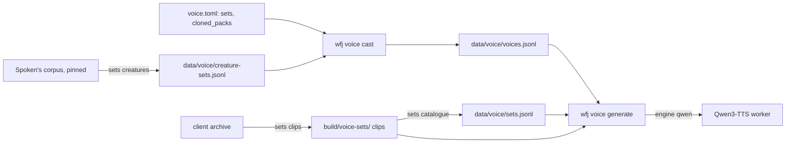

# Voice over

> Japanese audio for quest and NPC talk, book and letter pages and the character's own error lines, read aloud from the Japanese the addon ships. The audio lives in separate voice addons (the Voice entry, `WoWForeverJapanese_Voice`, and the packs `WoWForeverJapanese_Voice<Name>`); the main addon holds the player and plays nothing without them. Code: `Core/Voice.lua`, `Core/VoiceQueue.lua`, `UI/VoicePlayer.lua`, `UI/VoicePanel.lua` (and `VoicePanelText.lua`, `VoicePanelHead.lua`, `VoicePanelLooks.lua`), `UI/VoiceErrors.lua`, the `WoWForeverJapanese_RegisterVoice` global in `Main.lua`, the `voice.*` settings, `pipeline/wfj/cmd/voice.py` (and `voice_cast.py`, `voice_audition.py`, `voice_make.py`, `voice_ship.py`, `voice_store.py`, `voice_sets.py`, `voice_sets_page.py`), `pipeline/wfj/core/voice.py`, `pipeline/wfj/core/casting.py`, `pipeline/wfj/core/voice_sets.py`, `pipeline/wfj/io/aivis.py`, `pipeline/wfj/io/qwen.py`, `pipeline/wfj/io/qwen_worker.py`, `pipeline/wfj/io/qwen_modal.py`, `pipeline/wfj/emit/voice_pack.py`, `pipeline/wfj/core/voice_packs.py`, `pipeline/wfj/io/curseforge.py`, the voice readers in `pipeline/wfj/io/vmangos.py`, `pipeline/voice.toml`, `pipeline/voice-packs.toml`, `data/voice/`. Decisions: [ADR-061](../adr/061-voice-over-from-a-separate-pack.md), [ADR-062](../adr/062-voice-cast-per-speaker-in-step-with-the-text.md), [ADR-063](../adr/063-the-voice-panel.md), [ADR-074](../adr/074-voices-cloned-from-the-games-npc-voice-sets.md), [ADR-075](../adr/075-mute-the-english-voice-as-the-window-opens.md). Runbook: [Voice over](../operations/voice.md).

## Purpose
When the quest window, the NPC talk window or the book window shows a line in Japanese, a player with the voice installed hears it read aloud in Japanese, in the voice cast for whoever says it: a voice per kind of speaker (race or creature family, gender, age, archetype), the same voice for an NPC every time, a narrator for lines no creature says, and for book and letter pages the writer when the page is signed by a creature the game has, else a book narrator. While a line plays, the **voice panel** shows who is speaking and what is said, a sentence at a time, and the line goes on after its window closes. The character's own spoken error lines ("out of range") play in Japanese too, in a voice for the character's race and sex. The maintainer makes the audio from the Japanese the addon ships, for every voiced line in the game: 16,180 files, 1.2 GB, in the voice addons on CurseForge. Every line, in every pack, is read in a voice cloned with Qwen3-TTS 1.7B Base from one of the game's own voice sets ([Cloned game voice sets](#cloned-game-voice-sets)): an NPC's own set, a set chosen by rule for creatures with none, the narrator's and book reader's sets, and the player sets for the character's error lines. The engine runs on rented GPUs (Modal) by default, or on the maintainer's Mac. No AivisSpeech audio ships.

## How it works
```mermaid
sequenceDiagram
  participant C as Client (quest / gossip / book window)
  participant R as UI/Render
  participant S as Core/State
  participant P as UI/VoicePlayer
  participant V as Core/Voice
  participant VP as UI/VoicePanel
  C->>R: writes a line (Render.show)
  R->>R: shows the Japanese
  R->>S: fire "lineShown"(surface, record key, kind, id)
  S->>P: onShown
  P->>P: speaker(): creature id from UnitGUID (none for a book)
  P->>V: decide(surface, record key, kind, id, speaker)
  V-->>P: file path and length, or why not
  P->>P: panel on: queue the line (it waits while another plays)
  P->>C: PlaySoundFile(path, "Master"), dialog channel off
  P->>S: fire "voiceQueue"
  S->>VP: UI/VoicePanel draws VoicePlayer.state()
  Note over P: line ends (length + 0.5 s): the next waiting line starts
  Note over P: stops: setting off, loading screen, logout; panel Off also Alt and the window closing
  P->>C: StopSound, dialog channel back on
```

### What is voiced
| Window | Record | Pack key | Setting |
|---|---|---|---|
| Quest window, offer | `description` | `<quest id>-description` | `voice.offer` |
| Quest window, progress | `progress` | `<quest id>-progress` | `voice.progress` |
| Quest window, turn-in | `completion` | `<quest id>-completion` | `voice.turnin` |
| Quest window, NPC greeting panel | `greeting` | `g-<gossip key>` | `voice.greeting` |
| NPC talk window, greeting | `greeting` | `g-<gossip key>` | `voice.greeting` |
| Book window, a page | `page` | `b-<page key>` | `voice.books` |
| Dialogue UI's quest window, offer / progress / turn-in | `description` / `progress` / `completion` | as the quest window | as the quest window |
| Dialogue UI's quest window, greeting or NPC talk | `greeting` | `g-<gossip key>` | `voice.greeting` |
| Dialogue UI's book window, a page | `page<N>` (the book shows every page at once; with the voice panel off only the first page is a voice line, as a line stops the one before it) | `b-<page key>` | `voice.books` |

`Voice.KINDS` holds this table. Dialogue UI's windows ([ADR-073](../adr/073-dialogue-ui-windows-get-our-japanese.md)) use their own surfaces (`dialogueui.detail`, `.progress`, `.reward`, `.greeting`, `.gossip`, `.book`) with the same pack keys, so a line plays the same file whichever window shows it. Objectives, titles, option rows and every other surface are never voiced. The character's error lines are not a window's line: `UI/VoiceErrors` follows the game's own vocal error call (below). Forever's trainer window has no greeting text (the UI extract's `blizzard_trainerui` holds no greeting string), so there is nothing to voice there.

### The packs
The voice ships as several addon folders, split by `pipeline/voice-packs.toml` ([Voice over → Which pack holds a line](../operations/voice.md#which-pack-holds-a-line)): the **entry**, which holds no audio and on CurseForge requires the main addon and every pack, and one folder per **pack**, named for what it holds (`…VoiceLevels1to10` to `…VoiceLevels51to60`, `…VoiceOther`). Each is under 420 MB, the most one upload can carry.

```
WoWForeverJapanese_Voice/                 the entry
  WoWForeverJapanese_Voice.toc            ## Dependencies: WoWForeverJapanese; no files to load; the main addon's icon
  README.txt                              the packs it installs
WoWForeverJapanese_VoiceLevels1to10/      a pack (and so on for the others)
  WoWForeverJapanese_VoiceLevels1to10.toc ## Dependencies: WoWForeverJapanese; the main addon's icon; English-only notes
  Register.lua                            one call: WoWForeverJapanese_RegisterVoice({ format = 2, folder = "<its folder>", lines = { … }, creatures = { … } })
  Sound/<file>.mp3                        one file per line, and per voice for a line several voices say
  README.txt                              what it holds, the line count, the credits
```

Each `lines` entry is `[<pack key>] = { <file name>, <Japanese hash>, <seconds>, v = { [<voice id>] = { <file name>, <seconds> } } }`, the `v` table only for a line said by differently cast creatures; `creatures` maps each speaker of such a line to its voice. The Other pack also carries the character's own error lines (`errors`: the game's voice id → kind, and per race and sex the file of each message and kind). Every voice addon depends on the main addon, so the AddOn List shows them all under it (the list groups one level deep). The Japanese hash is `Hash.key` (the same function as the gossip key, `hashing.key` in the pipeline) over the shipped Japanese with its tokens unfilled (`{name}` stays `{name}`). One entry may point at another key's file: the female wording of a gendered gossip line is its own gossip key and plays the same file.

### Registration (`Core/Voice.lua`, `Main.lua`)
- The pack's `Register.lua` runs in its own addon and cannot see the main addon's namespace, so it calls the global `WoWForeverJapanese_RegisterVoice(tbl)`. It forwards to `Voice.register(tbl) → registered, invalid`.
- A table with the wrong `format`, the wrong `folder` or no `lines` is refused whole (`invalid = 1`). A pack's folder must start with `WoWForeverJapanese_Voice`. An entry is kept only when its file name matches `^[%w%-_]+%.mp3$`, its hash is 16 hex digits and its length is a number or absent; anything else is dropped and counted. A file name outside the pack's `Sound` folder is never built, so a pack cannot play another addon's file. Packs merge by folder: a second pack adds its lines, and a second registration of the same folder replaces only that folder's lines.
- The pack loads after the main addon (it depends on it), usually after the settings pages are built. When the registration brings the first pack, `Options.addPage("voice")` builds the *Voice* page and adds it under the addon's category ([Settings](settings.md)); a failure is recorded in `WFJ.initErrors` (surface `options.voice`).

### The decision (`Voice.decide`)
`Voice.decide(surface, recKey, kind, id, who, peek)` returns the file's path (`Interface\AddOns\<its pack folder>\Sound\<file>`) and its length, or nil and a reason, checked in this order:

| Reason | When |
|---|---|
| `kind` | the surface and record are not in `Voice.KINDS` |
| `off` | `voice.enabled` or the kind's setting is off |
| `english` | translation is off, or the reveal key is held |
| `nopack` | no pack registered |
| `missing` | the pack has no entry for the line's pack key |
| `notext` | the addon ships no Japanese for the line |
| `stale` | the pack's hash differs from the hash of the shipped Japanese |
| `heard` | the kind is kept to its first hearing and the line is in `WFJ_DB.voiceHeard` with the hash of the Japanese shipped now (never when `peek` is `true`) |

`peek`: `true` when only asking (the play button, the queue's re-check: the counts stay as they are and a heard line still answers its file); `"ahead"` when a window has just opened and the mute ahead asks whether its line will play (a heard line answers `heard`, the counts stay as they are).

A line with variants plays the file of the speaker on screen (`who`: its creature id and, for a creature shown as both genders, `UnitSex`), else the line's main voice. `missing`, `stale` and a played line (`matched`) are counted in `Voice.counts`, shown by `/wfj debug`. Core/Voice has no frames and no sound calls; its dependencies (lookup, hash, settings, reveal key, translation state) are passed in by `Main` at load.

### When a line starts
- `Render.show` fires State event `lineShown(surface, recordKey, kind, id)` only when the client has just written a line and the addon now shows it in Japanese (a write with the `apply` action). A refresh (the reveal key released, a setting switched) goes through `Render.refresh` and never fires it, so releasing Alt never restarts a line the player already heard. The event is fired under `pcall` after the write and the banner, so a failing listener cannot leave the window half translated. `UI/VoicePlayer` is its only listener.
- **With the voice panel on** (Panel size Full or Compact strip, the default): a line shown while another plays waits its turn in `Core/VoiceQueue` and plays when that one ends. A line already playing or waiting (same pack key) is not added again. A new line while one is paused takes over at once, like a line the player asks for (the player has moved on); the lines waiting stay waiting. A line that comes up while English shows (the reveal key held when the line before it ends) waits unstarted and starts when the key is let go: no voice starts while English shows. Each queued line carries what the panel shows: its Japanese as the window shows it (tokens filled in, an inline marker line removed), the English the client wrote into the window for it (memory only, never saved), the speaker's name and title as the client shows them now, and the speaker (creature id, sex, unit and GUID).
- **With Panel size Off:** one line at a time, as before the panel: a new line stops the one playing.
- Either way, the same line shown again while it plays is not restarted (the NPC talk window lays its first view out twice).
- **First time only.** With *Quest lines: only the first time* (`voice.questOnce`, off by default) a quest's offer, progress and turn-in are read aloud only the first time their window shows them; with *NPC greetings: only the first time* (`voice.greetingOnce`, on by default, since a vendor or trainer greets the same way at every visit) the same goes for greetings. Books and error lines are not covered. `UI/VoicePlayer` records a line once it has started playing (`Voice.markHeard`, from the window's line or the queue's head) in `WFJ_DB.voiceHeard[<pack key>] = <Japanese hash>` (account-wide; keys and hashes only, never text), so a line refused by the client or cleared from the queue before it played stays new. `Voice.decide` answers `nil, "heard"` when the key is there with the hash of the Japanese shipped now, so a line rewritten since counts as new. A heard line stays quiet but keeps the window's button on the play arrow: a click reads it (only asking, `peek`, is never stopped and never records). With the panel Off a heard line still stops another line of its window that was playing; the same line laid out again while it plays (the gossip window lays its first window out twice) goes on. The record is written only while the kind's setting is on, so turning one on later starts from what was heard while it was on.
- A new line of a window that will not play (no file, `missing`, `stale`, `notext`; its kind switched off, `off`; or English showing, `english`) hides that window's button, so the button never replays the previous line. With the panel Off it also stops that window's line; with the panel on the line playing goes on (it may be another NPC's, kept after its window closed).

### Playing (`UI/VoicePlayer.lua`)
- `PlaySoundFile(path, "Master")` returns whether it will play and a handle; `StopSound(handle)` stops it. The `Master` channel keeps the line audible while the dialog channel is off. The client reports no end of a sound, so the line counts as playing for the pack's length plus 0.5 s (30 s when an entry has no length), timed with `C_Timer.After`; a timer from a line stopped early finds a newer token and does nothing.
- **Stops (always):** translation is switched off, any voice setting changes, the player logs out (`PLAYER_LOGOUT`), the panel's close button, Panel size changed to Off (only that change: another panel setting changed while it is Off leaves a line playing). With the panel on, a loading screen (`PLAYER_ENTERING_WORLD`) also ends the line, empties the queue and clears the panel; with it Off a line goes on through one, as before the panel. `VoicePlayer.stop()` stops the sound and empties the queue.
- **Stops only with the panel Off:** the quest, NPC talk or book window hides (an `OnHide` hook on `QuestFrame`, `GossipFrame` and `ItemTextFrame`; for Dialogue UI's `DUIQuestFrame` and `DUIBookFrame`, added with `VoicePlayer.addWindow`, a child frame of ours that hides with the window, because Dialogue UI sets its window's `OnHide` script again after load and a `HookScript` would be dropped; a book's next page is a new line), and the reveal key going down. With the panel on, a closed window's lines keep playing and waiting while *Keep reading after the window closes* (`voice.panel.keep`) is on; with it off, the window's lines are dropped from the queue and, when the one playing was among them, the next waiting line starts. With the panel on, the reveal key never stops the voice: the panel shows the line's English instead (below).
- **A line the player asks for** (a window's or the quest log's play button, a row of the panel's waiting list) replaces the line playing: the interrupted line is dropped, never resumed after it. Lines waiting stay waiting.
- **Pause** stops the sound and keeps the line at the head of the queue; resume plays it again from the start (the client can only start and stop a sound file). Play again puts the panel's line (the head, or the last line once nothing is queued) at the front and plays it from the start. Key bindings: *Voice: pause / resume* (`WFJ_VoicePause`) and *Voice: play the line again* (`WFJ_VoiceReplay`), under the addon's header in the client's key bindings.
- **The game's English voice.** With `voice.muteDialog` on, while a line plays the addon sets `Sound_EnableDialog` to `0` if it was `1`, and records that in `WFJ_DB.voiceDialogMuted`. The client saves that setting, so a reload or a crash in between would otherwise leave the player's NPC voices off. It is put back to `1` when the line ends, on stop, at logout and on the next load (`VoicePlayer.init` restores it first). A player who had the dialog channel off keeps it off. Recovery by hand: `/console Sound_EnableDialog 1`.
- **Muted as the window opens** ([ADR-075](../adr/075-mute-the-english-voice-as-the-window-opens.md)). The client starts the NPC's English greeting as the window opens, before the window's text is written, so a mute taken only when the Japanese line starts came in mid-word or too late. `UI/VoicePlayer` listens to `GOSSIP_SHOW`, `QUEST_GREETING`, `QUEST_DETAIL`, `QUEST_PROGRESS` and `QUEST_COMPLETE`. From the event alone it works out the line the window will show (the gossip key of `C_GossipInfo.GetText()` or `GetGreetingText()`; for a quest panel `GetQuestID()` and the field, through `QuestFrame.fieldSource` when the panel's English is readable) and asks `Voice.decide(…, "ahead")`. When that line will play, it turns `Sound_EnableDialog` off at once, under the same rules and record as above (`voice.muteDialog` on, the player had it on). The mute is given back as soon as that window's voiced line turns out not to play (another translated line, a tooltip or the window's title, changes nothing), and after 1.5 s (`AHEAD_SECONDS`) when no line started; a line that starts holds it until it ends. Nothing is muted ahead for a line with no file, a kind switched off, a line heard before, the window's area (quests or gossip) switched off, while English shows, or while another line plays. Every window event also leaves one `voicetime` entry `window` in the log with the event and why nothing was muted ahead (`no text yet`, the first talk to an NPC whose text arrives after the event; `no Japanese`; `heard`; `missing`; `area off`; `a line is playing`; `dialog left as it is`), so an English greeting heard in game can be traced to its case. Checked in game: the client can start the greeting before the window's event (an NPC that speaks the moment it turns to the player), so its first split second is still heard; in every window logged the Japanese line had already started in the same moment as the event. The timing follows the Spoken addon's; the other voice-over addons are compared in the [research note](../research/2026-11-08-voice-over-addons-dialog-muting.md).
- **The window button.** A 28 px button at the window's top right (`TOPRIGHT`, -8, -31), on the band below the title, raised 10 levels above the window's art. It shows only while the voice panel is not on screen (Panel size Off, or the panel faded after the line): the panel has its own controls. It shows once a line of that window has started and hides when the window closes or its new line will not play (no file, its kind off, or English showing). While the line plays it shows the client's stopwatch pause icon (`Interface\TimeManager\PauseButton`) and a click pauses the line (with the panel Off, stops it); otherwise it shows the play arrow (`Interface\Buttons\UI-SpellbookIcon-NextPage-Up`) and a click resumes a paused line of that window or plays the window's line again from the start, replacing the line playing. The client can only start and stop a sound file, so a line cannot resume where it stopped. A click never plays while English is showing or `voice.enabled` is off. No text on it; `voice.button` hides it. Dialogue UI's quest window and book window get the same button (`VoicePlayer.addWindow`).
- **The quest log button** (`UI/VoiceQuestLog`). The same button at the right end of the quest log details' top bar (the world map's quest pane, `QuestMapFrame.DetailsFrame.BackFrame`), created on the first `QuestMapFrame_ShowQuestDetails`. Like the windows' buttons it shows only while the panel is not on screen (State `voiceButtons`, fired whenever the panel shows or hides, and on every voice change). Opening the log plays nothing (it is browsing). A click plays that quest's description as the pane shows it, voiced like its offer, through the queue and the panel like any other line, replacing the line playing; on the line playing it pauses (stops with the panel Off). It shows only when the line has audio, and `voice.button` hides it too. Play again (the panel's control and its key binding) asks `Voice.decide` again first, so it never plays a line whose kind was switched off since; that setting change also forgets the panel's last line.
- **The remembered speaker.** Every time the quest window shows its detail, progress or reward panel, translation on or off, `UI/QuestFrame` fires State `questShown(quest id, panel)` (`UI/DialogueUI` fires it too when it shows a quest page's Japanese) and, while a voice pack is installed, `UI/VoicePlayer` saves the quest NPC in `WFJ_DB.voiceSpeakers["<quest id>-description|progress|completion"] = { c = creature id, s = UnitSex, n = name, t = title }`, account-wide, as the client showed them; seeing the NPC again refreshes it ([Data model](../architecture/data-model.md)). A replay from the quest log takes the head (by creature id), the name, the title and the voice variant from it. A quest taken before the addon saw it, or one a player, an item or an object gave, has none: the panel shows the quest's title and no head. Nothing about it ships. Measured before deciding against a shipped speaker table: forever-vo's Forever captures against VMaNGOS quest givers and enders, 1,983 lines, 1,074 the same NPC, 908 unknown to VMaNGOS, 1 different (with the same cast).
- **The title** is the second line of the client's unit tooltip (`C_TooltipInfo.GetUnit`), skipped when it holds a digit ("Level 12 Humanoid"). Live text, kept with the queued line for the session only, and in the remembered speaker.
- `VoicePlayer.counts` keeps `played` and `refused` (no `PlaySoundFile`, or the client would not play the file).

### The voice panel (`UI/VoicePanel.lua`)
While a voiced line plays, a panel shows it. `UI/VoicePlayer` decides what plays and fires State `voiceQueue` on every change; the panel only draws what `VoicePlayer.state()` reports (`item`, `playing`, `paused`, `startedAt`, `seconds`, `waiting`, `last`). It is built on the first voiced line, so without a pack no frame exists. It never shows while translation or `voice.enabled` is off.

- **Where:** bottom centre (`BOTTOM`, 0, 96, where the client puts its own talking head), strata `HIGH`, clamped to the screen. A left-drag moves it unless *Lock the panel where it is* is on. Locked, it lets clicks through to the world under it (`SetMouseClickEnabled(false)`) while still sensing the mouse for its controls and the fade; unlocked, it takes clicks over its area so it can be dragged; the position is saved in `WFJ_DB.voicePanel.point` (the table is created the first time it is set). `/wfj panel reset` puts it back at the bottom centre.
- **What it shows:** the speaker's 3D head (`UI/VoicePanelHead`), the NPC's name and title as the client showed them (`<Innkeeper>`; a book shows its own name), and the line's Japanese a sentence at a time in step with the audio, with word cards on hover (surface `voicepanel`, [Readings](readings.md)).
- **Paging** (`UI/VoicePanelText`): the line splits after a run of 。！？ (so 「！？」 stays together, with its closing 」』）) and at line breaks; spaces and breaks around a sentence are trimmed, and a sentence under 12 characters joins the next (across a paragraph break too). A sentence longer than the look's lines hold (`pageChars`: 96 characters on the full looks, 64 on the strips) is split after 、, or at that length when it has no 、. Each page keeps where each of its pieces sits in the line, so the line's words map onto it whatever was joined or split. Each page starts at its share of the line's characters, and the page shown is the one the audio's elapsed share has reached, checked every 0.1 s. There is no going back by sentence: the audio cannot jump, so the text does not either. After the line ends the last sentence stays; a paused line shows its first.
- **The head:** the unit on screen while it is still the speaker (`SetUnit`), else `SetCreature(creature id)` from the client's creature cache, which loads after `/reload` and a restart. A new client build empties the cache, so an NPC not seen since has no head. A speaker with no model (a book, the narrator, an uncached creature) gets no head after 0.6 s and the text moves left. It plays the talk animation while the line plays. *Show the speaker's head* turns it off.
- **Looks** (`UI/VoicePanelLooks`, data only): two dropdowns choose one of four. Panel size Full / Compact strip and Panel style Dark / Parchment give look 1 Full Dark (the client's talking-head art: dark translucent backdrop, square portrait ring, gold name, white text, 570 × 155), look 4 Full Parchment (the default: the same frame on the player's faction talking-head kit, `TalkingHeads-Alliance` / `-Horde`, else `-Neutral`, dark name, black text), look 3 Strip Dark (520 × 62: a small head, the name, one or two lines on a plain dark band) and look 5 Strip Parchment (look 3 on the plain middle of the faction parchment, a larger name in the faction colour, a thin dark frame round the head). All art is the client's own; the addon ships no image. A client without the kit atlases gets look 1.
- **Controls** (top right, one row, 28 px; the client's close button at 26 px): pause / resume, play again, whole text, close. With *Show the controls only while the mouse is on the panel* on they show only under the mouse. Whole text opens a small scrollable window above the panel (`WFJVoicePanelText`, 480 × 300) with the line's whole Japanese and word cards, on parchment when the panel's look is parchment, for every line, a quest's too. A second click closes it. It never opens the quest log: calling Blizzard's `QuestMapFrame_OpenToQuestDetails` from addon code left the map's quest fields and the quest tracker tainted until a reload, and the next world map opened in combat was blocked with this addon blamed ([Client limits](../architecture/client-limits.md)). The old setting *The book button opens the quest in the quest log* (`voice.panel.questLog`) is gone; a saved value for it is ignored. Close stops the line and empties the queue.
- **The waiting list:** while any line waits, a compact list "Up next (click to play)" shows above the panel, as wide as its rows, one row per waiting line (`<name>  ·  Quest | Progress | Turn-in | Greeting | Book`), a faint gold band under the mouse. Clicking a row plays that line now and drops the line it interrupts. At most six rows show; the header counts the rest ("…ほか2件"). There is no next-line control.
- **The reveal key:** holding it (default Alt) does not stop the voice. The panel shows that line's English as the client wrote it into its window when the line started, whole, with no word cards; releasing it goes back to the Japanese page the audio is on. An open whole-text window does the same. The English is held in memory with that queued line only, never saved.
- **Fading:** with nothing playing (the line ended, or it is paused) and *Fade out after the last line* on, the panel fades over 0.6 s starting 3 s later (a line that is waiting unstarted while English shows counts as nothing playing). The mouse on the panel or the whole-text window being open holds it, and coming back during the wait or the fade brings it back whole. A panel that faded on a paused line stays away until something plays or the queue changes. With the fade off it stays until closed.
- **Under Dialogue UI:** Dialogue UI fades the whole interface (`UIParent`) out while its window is open, and under a faded `UIParent` only the panel's 3D head would draw (a model ignores its parent's alpha). While a Dialogue UI quest or book window is open, `VoicePanel.lift(true)` (from `UI/DialogueUI.liftPanel`) takes the panel and its tooltip out from under `UIParent` (no parent, at `UIParent`'s scale), so the panel shows whole over the window; `lift(false)` puts them back when the window closes; the panel stays lifted while the interface is still hidden after the window closes (Dialogue UI shows it again only out of combat), and comes down when `UIParent` shows again. `visible()` asks `IsVisible`, so the window button stands in whenever the panel is out of sight.
- **Combat:** with *Dim the panel in combat* on, its alpha is 0.4 between `PLAYER_REGEN_DISABLED` and `PLAYER_REGEN_ENABLED`; a panel built mid-combat starts dimmed (`InCombatLockdown()`).
- **The panel's own words** (the waiting list's header and kinds, the controls' tooltips) are Japanese like the other tool windows, English while the reveal key is held or translation is off, in the bundled face (its own tooltip, `WFJVoicePanelTip`).
- **Errors:** every panel listener is guarded. It shares the State events `enabled`, `modifier` and `voice` with `UI/Render`, which must run whatever happens in the panel.
- **Settings changes** redraw the panel (State `voicePanel`) and never stop the line, except changing Panel size to Off, which stops it, hides the panel and forgets its last line (so play again does nothing with the panel off).

### The character's error lines (`UI/VoiceErrors.lua`)
- The error frame's `TryDisplayMessage` plays the game's English line through `C_Sound.PlayVocalErrorSound(voiceID)`. A hook after that call notes the voice id; a hook after `TryDisplayMessage` reads which message it showed (`GetGameMessageInfo`) and plays that message's Japanese recording, so the voice says the words on screen; a call from anywhere else plays the voice id's kind line. Both hooks follow the client's code, never replace it.
- While a pack has lines for the character's race and sex, the client's error speech (`Sound_EnableErrorSpeech`) is turned off and the change kept in `WFJ_DB.voiceErrorSpeechMuted`; it is put back when switched off, at logout and on the next load. A player who had it off keeps it off. The same line is not started again within 2 seconds.

### Settings
`voice.enabled`, `voice.offer`, `voice.progress`, `voice.turnin`, `voice.greeting`, `voice.books`, `voice.errors`, `voice.muteDialog`, `voice.button` (label "Show the play / pause button on the window when the voice panel is not showing"), all on by default, and the first time only pair, `voice.questOnce` ("Quest lines: only the first time", off by default) and `voice.greetingOnce` ("NPC greetings: only the first time", on by default), on the *Voice* page. The panel's settings are on their own page, *Voice panel* (the settings pages do not scroll and the Voice page was full):

| Setting | Label | Default |
|---|---|---|
| `voice.panel.size` | Panel size: Off / Full / Compact strip (a dropdown) | Full |
| `voice.panel.style` | Panel style: Dark / Parchment (a dropdown) | Parchment |
| `voice.panel.keep` | Keep reading after the window closes | on |
| `voice.panel.head` | Show the speaker's head | on |
| `voice.panel.hoverButtons` | Show the controls only while the mouse is on the panel | on |
| `voice.panel.fade` | Fade out after the last line | on |
| `voice.panel.combatDim` | Dim the panel in combat | on |
| `voice.panel.lock` | Lock the panel where it is | off |

`Core/VoiceQueue.opt` maps the panel's choices onto these settings. Settings from earlier panel builds (`voice.panel`, `voice.panel.strip`, `voice.panel.parchment`, `voice.panel.queueBox`, `voice.panel.ruby`) are carried into Panel size and Panel style once and dropped. All voice settings are hidden (`Settings.isHidden`) until a pack registers: a player without the pack sees no setting that does nothing, in the settings pages or in `/wfj`'s status. Both pages sit under the addon's category ([Settings](settings.md)); the registration that brings the first pack adds both (`Options.addPage("voice")` and `("voicepanel")`, failures recorded as `options.voice` and `options.voicepanel`).

### `/wfj debug`
`voice: N lines (N invalid) · matched N · missing N · stale N · played N · refused N`, then `voice packs:` with each pack folder and its line count, a `voice panel: look N · N waiting · playing <pack key or none> · paused yes/no` line, and the error lines' counts (`voice errors: game asked N · message known N · played N · repeats skipped N · refused N`, and the last silent one). Without a pack: `voice: no pack`, with `(a pack registered an invalid table)` when one was refused. The About page names the packs that loaded, or shows the Voice entry's CurseForge address.

### The pipeline (`wfj voice`)
- **`speakers`** (`make voice-speakers`) writes `data/voice/speakers.jsonl` (pack key → its main speaker, a creature id or `narrator`, and `others` who say it too) for every voiced line ([Data model](../architecture/data-model.md#voice-over-tables)). From the pinned VMaNGOS database: a quest's offer is read by the creature that starts it, its progress and turn-in by the creature that ends it; a quest an object or item starts has the narrator; gossip menu greetings and quest greetings become gossip lines. The quest cache's conditional descriptions and forever-vo's player captures fill speakers the database lacks; a creature id the collector recorded (`npcs` in `data/english/gossip`) wins over the database ([Collector](collector.md)). A gossip line that ships as the English it is (Latin letters and no kana or kanji: a made-up language, a name alone) gets no speaker, so it is never voiced (`voice.kept_in_english`). A book or letter page is read by its writer when its last line is a signature naming exactly one cast creature, else by the book narrator. A signature is a name after one or two hyphens, an en or em dash or a tilde, maybe followed by a title after a comma or " - " ("- Windan Shay", "--VanCleef", "-Thrall, Warchief of the Horde"), or an undashed name that does not read as a title ("The End" does not count; a single word only under a closing line such as "Your friend,"). It also runs `levels`.
- **`profiles`** (`wfj voice profiles`) builds `data/voice/profiles.jsonl`: per speaking creature its race (or family), gender, age, archetype and role, from the client's display tables first, VMaNGOS second, and a machine casting pass for what only judgement gives, each field with its own provenance; a maintainer value is never overwritten.
- **`cast`** writes `data/voice/voices.jsonl` (creature → roster voice, and the cast row that chose it; a creature shown as both genders gets both) from the profiles, `voice.toml`'s cast rows and the overrides. A creature keeps its voice; neighbours spread over a row's voices. Every creature then moves to a game voice set's cloned voice ([Cloned game voice sets](#cloned-game-voice-sets)). The AivisSpeech cast rows are still in `voice.toml`, but no committed speaker ends on them: `test_no_committed_speaker_is_cast_to_anything_but_a_game_voice_set` fails if one does.
- **`plan`** prints what `generate` would make now, by cast row and voice, with characters and hours.
- **`generate`** (`make voice-generate`, `make voice-run` for the whole game in the background) reads every voiced line's shipped Japanese through the engine its roster voice names, which is Qwen3-TTS for every voice cast today ([`pipeline/voice.toml`](../operations/voice.md#configuration): roster voices and their settings, pace) into the audio store (`build/voice/audio/<key>[_<voice>].mp3`) and records each file in `data/voice/audio.jsonl`, with its size and SHA-256. The text read is the shipped Japanese with `{name}`, `{class}` and `{race}` spoken as 冒険者 and a `<…>` stage direction holding non-ASCII text dropped; any other markup stops the run with the line's key. A file is made again only when its fingerprint (Japanese hash, roster voice, style, speed, pitch, intonation; for a cloned voice, its set, mode and reference instead) changed, so recasting one kind of speaker remakes only its lines; the engine version is recorded beside the fingerprint, not in it (`aivis@<version>` or `qwen3-tts@<version>` in the record's provenance). The AivisSpeech path (starting that engine for a run when it has files to make) is still in the code but has nothing to make. `make voice-generate` passes `--remote`: the cloned lines are exported (`wfj voice export`) and read on rented GPUs by `pipeline/wfj/io/qwen_modal.py`, then encoded and recorded from the run's WAVs (`--prepared <run>`); with `VOICE_LOCAL=1`, and always for `make voice-run`, the local Qwen3-TTS worker reads them instead ([runbook](../operations/voice.md#steps)). A line the engine cannot read is logged and left for the next run; the run goes on. A run over the whole game (`--scope all --players all`, what `make voice-generate` runs) drops the record rows of files no line uses any more (a recast, a removed line), so `data/voice/audio.jsonl` lists exactly the files the packs carry.
- **`pack`** (`make voice-pack`) writes the entry and every pack under `build/voice-pack/` from the audio record's files whose Japanese hash still equals the shipped Japanese (the rest are counted as left out), split by quest level as `pipeline/voice-packs.toml` says. A quest's level is Forever's own, from the committed `pipeline/voice_quest_levels.txt` (the quest cache's level at payload offset 8, else VMaNGOS). It prints each pack's size and room under the cap, marks a pack past 315 MB, and writes nothing when one is past 420 MB, when there is no audio store, or when a store file is not the recorded take (its SHA-256 differs from the audio record's: the one shared store may hold another branch's remake). The TOCs' `## Interface` is copied from the main addon's TOC.
- **`release`** (run by the voice job of the Release workflow; `make voice-release DRY=1` locally) refuses unless the audio store sits at the pinned commit, then builds, zips and checks every folder, uploads the packs whose content changed since the latest `voice-v*` GitHub release to their CurseForge projects (the entry when the set of packs changed), and makes one GitHub release with every zip and one zip of everything ([Voice over → Releasing the voice](../operations/voice.md#releasing-the-voice)).
- **`store-sync`** (`make voice-sync`; `voice-run` and `voice-generate` end with `store-sync --if-changed`, which does nothing when the run made no file) commits the audio store's new files to the audio repository (`zyaga/wow-forever-japanese-voice`, checked out at `build/voice/`), pushes, and writes that commit to `pipeline/voice-audio-commit.txt`: the audio that goes with this text.
- **`levels`** (`make voice-levels`, run by `voice-speakers`) writes `pipeline/voice_quest_levels.txt`, each quest's level from the quest cache and VMaNGOS, so `pack` and `release` split the packs without the client files.
- **`make voice`** runs speakers, generate and pack. `build/` is gitignored in this repository: the MP3s are committed only to the audio repository, the packs never.
- **`wfj validate`** checks `data/voice/` (`rule_voice`): well formed rows, provenance on each, no duplicate key or creature, a voice row for every creature that speaks, the casting in step with `voice.toml`, no creature cast to a voice of the other gender (its profile's gender against the voice's gender; a set Spoken gave that creature is left out, since Spoken's gender wins, and a set the `[[set_cast]]` rules chose is checked like any other voice), and prints how many files are in step, stale or not made.
- **The CI gate:** `tests/python/test_voice.py::test_audio_in_step` fails a pull request when a voiced line has no recorded audio, or audio made from other Japanese or in another voice, or when the record lists a file no line uses. Remake with `make voice-generate`.

### Cloned game voice sets
The game gives most humanoid NPCs one of its NPC voice sets: each playable race and gender has two or three, recorded by different actors (`humanmalestandardnpc`, `nightelffemalepriestessnpc`, `orcfemalestandardnpc` and so on). Each such NPC speaks Japanese in a voice cloned from its own set's barks, so it sounds like itself in the English game ([ADR-074](../adr/074-voices-cloned-from-the-games-npc-voice-sets.md)).



- **The sets.** 72 in all, one row each in `data/voice/sets.jsonl`. 56 NPC sets: the 52 race, gender and flavour sets with a folder (`sound/creature/<set>/`) in Forever's archive, plus four Forever adds for the Skyborne elves, which have no folder name and are named after their NPCSounds row (`skybourneelffemale3773npc`, `skybourneelffemale3774npc`, `skybourneelfmale3775npc`, `skybourneelfmale3776npc`). 16 player sets (`<race><sex>playernpc`), cut from the character's own error recordings for the error lines (below). `core/voice_sets.parse` reads a set name into race, gender and flavour.
- **Which set an NPC speaks with** (`wfj voice sets creatures`, `make voice-sets`) is exactly the Spoken voice addon's assignment, read from its committed line corpus at the commit pinned in the Makefile (`SPOKEN_COMMIT`, fetched into `build/spoken/` by `make voice-spoken-fetch`, never committed). Each corpus line names its NPC and a voice `<race>-<gender>-<flavour>`; an NPC takes the voice most of its lines use, per gender. Spoken voices that are no game set (its narrator, its per-model voices) are left out. `data/voice/creature-sets.jsonl` holds one row per speaking creature Spoken voices with a set: `creature`, `male` and/or `female` (the set), and provenance `spoken@<first 7 of the commit>`. A row whose sets are unchanged keeps its date.
- **The clips** (`wfj voice sets clips`, `make voice-sets-clips`) are each set's greeting, farewell and vendor barks, cut from the local archive into `build/voice-sets/<set>/` of the main checkout as 24 kHz mono WAV, with `manifest.json` (set → file id and clip name). A set's files are found in the community listfile; a Skyborne set's are the first two sound kits of its NPCSounds row (greeting and farewell) through `SoundKitEntry`. A clip already cut is not cut again. The clips stay under `build/` on the maintainer's machine: they are never committed to this repository or the audio repository, never packed, and `tests/python/test_voice_sets.py` fails when any `.ogg` or `.wav` file is tracked outside `tests/`.
- **The catalogue** (`wfj voice sets catalogue`, `make voice-sets-catalogue`) writes `data/voice/sets.jsonl`: per set its gender, provenance `client@<build>` and its clips, each with its file id, an English transcript from a local speech-to-text model (the `whisper` command, model small), a `full` flag and machine provenance. `full` is true when every word of the transcript is a plain English word (the system word list plus a few game words): a greeting in a made-up language must not join a full-copy reference. A clip already in the file keeps its transcript, flag and provenance, so a hand fix for a misheard lore word survives a rebuild; only new clips are transcribed.
- **References.** A voice-only copy uses the speaker embedding of all the set's clips joined (0.35 s of silence between), with no transcript. A full copy joins only the clips flagged `full` and passes their transcripts, so the model copies the voice and the way it speaks. Joined references are written once to `build/voice-sets/refs/<set>-<mode>-<ref hash>.wav`. The ref hash covers the clips' file ids and, for a full copy, their words. For a remote run, `wfj voice export` copies the references the run needs into the run folder, and they are sent to the rented GPU containers for that run only (each container writes them to its `/tmp`, which is not kept). They are never archived (`archive_run` skips `refs`), committed or packed.
- **Picks** (`voice.toml`, one `[sets.<set>]` table per set): `pick` is `voice` or `full`, and `decided` marks a verdict by ear. The starting picks are `voice` for male sets and `full` for female sets. Every set picked `voice` or `full` becomes a roster voice `q<set without "npc">` (`qhumanmalestandard`), engine `qwen`, licence Apache-2.0. Its fingerprint is `<Japanese hash>|<voice>|qwen|<set>|<mode>|<ref hash>`, so a new pick, new clips or a fixed transcript remakes that set's lines.
- **Casting** (`core/voice_sets.clone_cast`, after the usual cast in `wfj voice cast`): a creature whose home pack is listed in `cloned_packs` (every pack now) and whose set has a cloned voice in the roster is cast to it (cast row `set <set>`). A creature with both a male and a female set gets the male set as its voice and the female set as its female variant. The home pack is the lowest level band of the quests the creature starts or ends, else Levels 1-10 (where talk with no quest goes). A creature pinned in `data/voice/overrides.jsonl` keeps its pin. Every line of the creature follows its cast, in every pack, so the creature table stays one voice per creature.
- **The engine, remote** (`io/qwen_modal.py`, the default): `make voice-generate` exports the run (`jobs.jsonl`, `refs/`, `refs.json`) and runs `qwen_modal.py` with the `modal` client's own environment, `build/modal/venv` (`make voice-modal-setup`; the pipeline never imports it). Each L40S container loads the same pinned `qwen-tts` once and reads its lines with the same worker code; the WAVs come back to the run's `wav/` folder, and a rerun reads only the lines with no WAV yet. Every run's WAVs, jobs, reference transcripts and manifest are then archived with a `SHA256SUMS` file to `VOICE_WAV_ARCHIVE` (set privately); the references are left out. If archiving fails, the run still imports, and `wfj voice generate --prepared <run> --archive <dir>` archives it later.
- **The engine, local** (`io/qwen.py`, `io/qwen_worker.py`, `VOICE_LOCAL=1`): Qwen3-TTS 1.7B Base (`Qwen/Qwen3-TTS-12Hz-1.7B-Base`) in its own environment, `build/qwen/venv` of the main checkout (`make voice-qwen-setup`, `qwen-tts` 0.1.1); its path is `qwen` in `voice.toml`. The pipeline starts `qwen_worker.py` with that Python and sends one JSON request per line over stdin (text, reference WAV, reference transcript or none, mode, output path); the worker answers one JSON line per request. It reads a line's paragraphs one at a time, joined with 0.6 s of silence, on the Mac's GPU when there is one. A lock file in the temp folder lets one run hold the engines; a second run is refused ("another voice run is making cloned voices"). Over that, `build/voice-run.lock` in the main checkout lets one `generate`, `export` or `relevel` run at a time, whichever engine reads the lines, because each rewrites the whole audio record. A generation run reads `build/voice-speed` before each line: slow is one engine in macOS's background tier (`taskpolicy -b`), fast is three side by side at normal priority (`make voice-speed`). The worker's own output goes to `qwen.log` in the audio store folder. Only the worker imports PyTorch; the pipeline stays on the standard library.
- **Credits.** A pack's README credits "Speech engine" (each engine its files were made with, named in `[credits]` in `voice.toml`), "Voices" and "Licences". For cloned voices the licence line is "speech engine Apache-2.0; the game's NPC recordings the voices are modelled on belong to Blizzard Entertainment". It also says the maintainer ran the engine on their own computer and on rented GPUs, and that no hosted speech service was used.
- **The listening page** (`wfj voice sets-page build|serve|apply`): one row per set with its game clips joined, the voice-only take and the full take of a fixed male or female line (by the set's gender), then the pick (`voice` or `full`) and the decided tick. `build` makes only the takes that are missing, in one low-priority Qwen3-TTS run; everything stays in `build/voice-sets/page/` of the main checkout, because it carries game audio. `serve` serves it on `127.0.0.1:8767` and saves each change at once to `page/picks.json`; a rebuild shows them. `apply` writes the saved picks into `voice.toml`'s `[sets]` tables and checks the result loads.
- **Everyone else on a set too.** A speaker Spoken gives no set takes one from the `[[set_cast]]` rules in `voice.toml` (first match on race, gender and archetype; a creature shown as both genders is matched once as each, a sexless one as male); a creature with no profile matches the last, catch-all rule. `narrator_set` and `book_narrator_set` give the narrator and the book reader a set (the tauren male elder). The character's error lines use the player sets `<race><sex>playernpc`, cut from the player character's own error recordings (`sound/character/<race>/<race><sex>errormessages/`, the first 16 by name; the Forsaken as `undead`), and the Skyborne use their NPC sets (`PLAYER_SETS` in `cmd/voice_make.py`). No line is read in any other voice.
- **Loudness.** `to_levelled_mp3` levels every take to -20 LUFS with one linear gain (measured with ffmpeg's `ebur128`), keeps its peaks under -2 dBFS with a limiter, and pipes the result straight into LAME; length and voice are unchanged. A silent take, or one shorter than 400 ms (one gating block), has nothing to measure and is left as it is. `wfj voice relevel <run>…` re-encodes recorded cloned files from the runs' kept WAVs (`wav/` and `local/`) and updates their bytes and hashes in the record.

## Key files
- `addon/WoWForeverJapanese/Core/Voice.lua`: the registry, `decide`, `packKey`, counts. Pure.
- `addon/WoWForeverJapanese/Core/VoiceQueue.lua`: the order lines play in while the panel is on, and the panel's choices mapped onto the `voice.panel.*` settings. No frames, no sound calls.
- `addon/WoWForeverJapanese/UI/VoicePlayer.lua`: every sound and client-setting call for window lines, the queue's driver, the speaker and its title, the window buttons, the window hooks, `state()` for the panel.
- `addon/WoWForeverJapanese/UI/VoiceQuestLog.lua`: the quest log's play / pause button and the remembered speaker.
- `addon/WoWForeverJapanese/UI/VoicePanel.lua`: the panel's frame, layout, fade, controls, waiting list and `/wfj panel reset`. `UI/VoicePanelText.lua`: paging, each page's words, the English view, the whole-text window. `UI/VoicePanelHead.lua`: the model. `UI/VoicePanelLooks.lua`: the four looks as data.
- `addon/WoWForeverJapanese/UI/QuestFrame.lua`: fires `questShown` for the remembered speaker.
- `addon/WoWForeverJapanese/UI/VoiceErrors.lua`: the character's error lines.
- `addon/WoWForeverJapanese/UI/DialogueUI.lua`, `UI/DialogueUIBook.lua`: show the lines in Dialogue UI's windows and register those windows with `VoicePlayer.addWindow` (speaker unit `npc` for the quest window, none for the book); `DialogueUI.liftPanel` lifts the voice panel out from under the faded interface while either window is open.
- `addon/WoWForeverJapanese/Main.lua`: `WoWForeverJapanese_RegisterVoice`, the load steps `voice`, `voicequeue`, `voiceplayer` and `voicepanel`, `PLAYER_LOGOUT`.
- `addon/WoWForeverJapanese/UI/Render.lua`: fires `lineShown`.
- `pipeline/wfj/core/voice.py`: the scope, who speaks, the text read, the fingerprint, the in-step comparison, the validate checks. Pure. `pipeline/wfj/core/casting.py`: profiles and casting. Pure.
- `pipeline/wfj/cmd/voice.py`, `pipeline/wfj/io/aivis.py`, `pipeline/wfj/emit/voice_pack.py`, `pipeline/wfj/io/vmangos.py`.
- `pipeline/wfj/core/voice_sets.py`: set names, the cloned cast, the gender check. Pure. `pipeline/wfj/cmd/voice_sets.py`: `sets creatures|clips|catalogue` and the references. `pipeline/wfj/cmd/voice_sets_page.py`: the listening page. `pipeline/wfj/io/qwen.py`: the Qwen3-TTS client and its lock. `pipeline/wfj/io/qwen_worker.py`: the worker, run in its own environment. `pipeline/wfj/io/qwen_modal.py`: the remote run on Modal, run with `build/modal/venv`.
- `pipeline/wfj/core/voice_packs.py`: which pack holds a line, content hashes and versions. Pure. `pipeline/wfj/cmd/voice_ship.py`: `pack` and `release`. `pipeline/wfj/io/curseforge.py`: the upload API.
- `pipeline/voice.toml`, `pipeline/voice-packs.toml`, `pipeline/voice_quest_levels.txt`, `pipeline/voice-audio-commit.txt`, `data/voice/` (profiles, speakers, voices, audio record, error tables, `creature-sets.jsonl`, `sets.jsonl`).

## Invariants
- Japanese voice starts only while Japanese shows (a waiting line included: it starts when the reveal key is let go). The master switch stops it. With the panel Off, the reveal key and closing the window stop it, and nothing restarts it on release. With the panel on, the voice goes on while the reveal key is held (the panel shows the English the client wrote for that line, from memory) and, while *Keep reading* is on, after the window closes.
- The panel draws only; `UI/VoicePlayer` keeps every sound and client-setting call. Turning the panel off leaves the voice over as it was without it.
- The panel shows no shipped English. Names and titles on it, and in `WFJ_DB.voiceSpeakers`, are what the client showed this player, kept on the player's machine, never shipped.
- A line plays only when the pack's hash equals the hash of the Japanese the addon ships for that key. A stale or missing line stays silent; it never voices other words.
- The pack holds Japanese audio only; the speakers table holds keys and creature ids, never English. Names in the Japanese stay English and are read as written.
- The main addon never depends on the packs and reads them only through the registered tables. Without a pack nothing plays and no voice setting shows; the About page says the voice is not installed and shows the Voice entry's CurseForge address to copy, and with packs it names the ones that loaded.
- Every change to `Sound_EnableDialog` and `Sound_EnableErrorSpeech` is recorded in `WFJ_DB` and undone. A mute taken as a window opens is given back within 1.5 s when no line starts.
- The heard record (`WFJ_DB.voiceHeard`) holds pack keys and Japanese hashes, never text. A play button click always reads its line.
- An NPC always has the same voice; a line said by differently cast NPCs plays the voice of the one on screen.
- A man is never heard in a woman's voice, or the other way round: a cloned NPC takes its set's gender, and `validate` fails when a creature is cast to a voice of the other gender.
- The game's own audio is never committed, archived or shipped: the cut clips, joined references and listening page stay under `build/` on the maintainer's machine, and no `.ogg` or `.wav` is tracked outside `tests/`. It leaves the machine only during a remote run, when the joined references go to the rented GPU containers for that run and are not kept there.
- No AivisSpeech audio ships: every committed speaker is cast to a game voice set.

## Edge cases
- A line whose Japanese changed after the pack was made: `stale`, silent, counted. `make voice` remakes only the changed files.
- A gendered gossip line: the female wording has its own key and plays the male wording's file.
- The player's name, class or race in a line: spoken as 冒険者.
- A reload or crash while a line plays: the next load turns the dialog channel back on.
- A greeting heard before, with *NPC greetings: only the first time* on: silent, the English greeting plays as the client has it, and the window's button reads the Japanese on a click. A greeting whose Japanese changed since is read once more.
- Two NPC windows opened within 1.5 s: the second window's event takes its own mute; the first one's timer finds a newer token and does nothing.
- The pack loads before the settings pages exist: the *Voice* and *Voice panel* pages are built with the others (`requires`).
- Two NPCs talked to in a row: the second line waits in the list and plays when the first ends; a click on its row plays it now and drops the first.
- A quest replayed from the log that the addon never saw handed out: the quest's title stands in for the name, no head. After a new client build, heads come back as the NPCs are seen again; names and titles stay.
- The panel faded on a paused line: it stays away until something plays or the queue changes; the window button is back meanwhile.
- Dialogue UI's window open: Dialogue UI fades the game's interface out while it shows (its own setting); the panel is lifted out from under that interface for the time the window is open, so it shows whole over the window, and goes back under it when the window closes. With the panel off or faded, the window button on Dialogue UI's window stands in. Holding the reveal key there redraws Dialogue UI's page but never restarts the line.

## Not in this build
- Quest objectives (not voiced), audio per class or race (spoken as 冒険者).

## Unverified in game
Listed with their steps in [Testing strategy → Voice over checklist](../testing/strategy.md#voice-over-checklist): `PlaySoundFile(path, channel)` and playing an MP3 from an addon folder; setting `Sound_EnableDialog` from an addon; whether a new pack folder needs a full client restart; whether the Settings panel lists a subcategory added after `RegisterAddOnCategory`; whether the pack loads after the main addon's `ADDON_LOADED`; that on Forever the NPC's English greeting starts at the window's event and a dialog mute taken there silences it from its start (taken from the Spoken addon's code, not traced on Forever). The panel's own steps are in [Testing strategy → Voice panel checklist](../testing/strategy.md#voice-panel-checklist); still unverified there: the talk animation id (60, the head's mouth moves) and the title being the unit tooltip's second line.

## Related
- [ADR-061](../adr/061-voice-over-from-a-separate-pack.md) · [ADR-062](../adr/062-voice-cast-per-speaker-in-step-with-the-text.md) · [ADR-063](../adr/063-the-voice-panel.md) · [ADR-073](../adr/073-dialogue-ui-windows-get-our-japanese.md) · [ADR-074](../adr/074-voices-cloned-from-the-games-npc-voice-sets.md) · [Readings](readings.md) · [Voice over runbook](../operations/voice.md) · [Settings](settings.md) · [Collector](collector.md) · [Pipeline](pipeline.md) · [Addon modules](../architecture/addon-modules.md) · [Data model](../architecture/data-model.md) · [ADR-075](../adr/075-mute-the-english-voice-as-the-window-opens.md) · [Research](../research/2026-10-04-japanese-voice-over.md) · [Dialog muting in other voice-over addons](../research/2026-11-08-voice-over-addons-dialog-muting.md)
