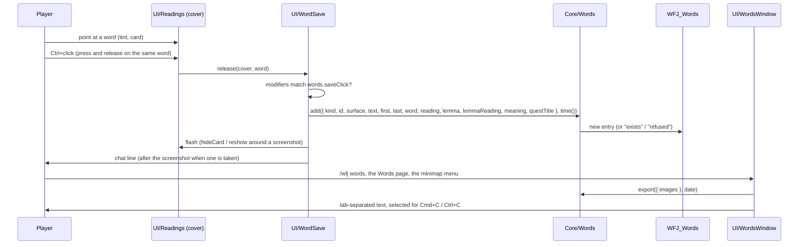

# Word list

> The player's saved words: the save click on a highlighted word keeps it, with its reading, meaning and sentence, in an account-wide list that an export window turns into tab-separated text for a text file, a spreadsheet or Anki. Code: `Core/Words.lua`, `UI/Readings.lua` (reads the save click), `UI/WordSave.lua` (saves), `UI/ReadingPopup.lua` (the card's hint), `UI/WordsWindow.lua`, the Words page in `UI/Options.lua`, `UI/OptionsText.lua`, `UI/MinimapButton.lua`, `UI/Slash.lua`, the `words.saveClick` and `words.screenshot` settings in `Core/Settings.lua`, the `words` load step in `Main.lua`. Decision: [ADR-069](../adr/069-saved-word-list.md).

## Purpose
A learner who meets a word worth keeping can save it without leaving the game, and later study it elsewhere. The list holds what the [word card](readings.md) already shows (the word, its reading, its dictionary form and meaning) plus the sentence it came from, so a card made from it has context. The addon only keeps the list and shows it as text: it never writes a file of its own and never talks to another program.

## How it works


### Saving
The save click is read by `UI/Readings` while the mouse is over a covered word and handed to `UI/WordSave`, which checks the modifiers and saves; the cover never takes the click ([Readings → Saving a word](readings.md#saving-a-word)). The setting `words.saveClick` picks it: `ctrl` (default), `shift`, `meta` (Cmd, Mac client only), `click` (no modifier) or `off`. It is never the reveal key's own modifier; changing the reveal key onto it moves it to the next free choice ([Settings → The save click and the reveal key](settings.md#the-save-click-and-the-reveal-key)).

`Words.add(input, now)` returns:
- `added`: a new entry. The tint flashes and chat prints `Saved: <word> (N words)`, in English and Japanese on one line.
- `exists`: an entry with the same key is already in the list; nothing changes. Chat prints `Already saved: <word>`.
- `refused`: the list was saved by a newer addon version (below), or the input is incomplete. Chat prints that the list cannot be changed here.

### The key
An entry's key is `<kind>:<id>:<dictionary form>`, or `<kind>:<id>:<word>` when the word has no dictionary form (a word with no meaning, or a class / race word). `kind` and `id` are the reading row's: `quest.description:456`, `gossip:<16-hex English hash>`, `ui:<string key>`, `book:<English hash>`. So:
- the same word saved again from the same text is not added twice, even as another inflection (倒して and 倒した in one quest description share 倒す);
- the same word from another quest, NPC line, page or label is a new entry, with its own sentence;
- a reworded translation keeps its key, because the key holds no Japanese line text.

The key index is rebuilt from the entries on load and kept in memory only; it is never saved.

### An entry
| field | holds |
|---|---|
| `key` | the key above |
| `word`, `reading` | the word as shown and its whole reading |
| `lemma`, `lemmaReading` | the dictionary form and its reading (empty when the word has none) |
| `meaning` | the word card's meaning, whether or not meanings are shown; empty when none. A class or race word's meaning is its English name, as its card shows ("Druid (a class)") |
| `sentence` | the Japanese sentence around the word, as shown |
| `wf`, `wl` | the word's first and last byte inside `sentence` |
| `kind`, `id` | the reading row's kind and id |
| `source` | where it was shown: `quest`, `gossip`, `book` or `window` |
| `questId`, `questTitle` | for a `quest.*` kind only: the quest id and the shipped Japanese quest title |
| `saved` | `time()` at the save |
| `shot` | the screenshot's file name, when one was taken |

- **The sentence** is cut at 。！？!? or a line break on each side of the word. A sentence longer than 200 bytes (a quest paragraph with no full stop) is trimmed around the word, a whole character at a time from the side farther from it, so a character is never split. It is the Japanese the player saw, so where the line names the character it holds the character's name: the player's own data, on the player's own machine.
- **The source** comes from the surface the word was shown on: `questframe.*` and `questmap.*` are `quest` (a quest-window line keyed by its English, such as a conditional description, is still quest text, with no quest id); `gossip` is `gossip`; `itemtext` is `book`; on the voice panel a `quest.*` kind is `quest`, `book` is `book` and anything else `gossip`; every other surface is `window`.
- Tabs and line breaks inside any field become spaces, so a field never breaks the export's columns.

### Persistence
The list is the SavedVariables table `WFJ_Words`, account-wide (every character shares one list):

```lua
WFJ_Words = { schema = 1, entries = { <entry>, … }, everSaved = true | nil }
```

- `Main.lua` loads it with `WFJ_Words = step("words", function() return WFJ.Words.load(WFJ_Words) end) or WFJ_Words`: a load that fails keeps the saved table, so the client never writes an empty list over it. The failure is listed in `WFJ.initErrors` under `words`.
- `Words.load` keeps entries in their saved order, drops anything that is not an entry with a string key, and keeps the first of two entries with the same key. A missing or garbled table starts an empty list without an error.
- `everSaved` is set by the first save and kept through Clear all. The word card's hint shows until it is set.
- The client writes SavedVariables on `/reload`, logout and a normal exit. A crash loses the words saved since the last of those.

**Versions.** A list saved by a newer addon version (a higher `schema`) is kept exactly as it is: saving, Remove last and Clear all are refused with a chat line, and it is never written in this version's shape. Export still works; every field goes through the same cleaning, so a missing field is an empty column. An older addon version does not list `WFJ_Words` in its TOC, so the client drops the table at that version's first logout. A player going back to an older version exports the list first.

### Screenshots
With `words.screenshot` on (off by default), a save also takes a game screenshot:

1. The word card (or the reading box) hides; the gold tint stays, so the image shows which word was saved.
2. `Screenshot()` runs, and the save waits for the client's answer.
3. On `SCREENSHOT_SUCCEEDED` the entry's `shot` is set to `WoWScrnShot_<MMDDYY>_<HHMMSS>.<ext>`, from the local time at the event and the screenshot format setting (`GetCVar("screenshotFormat")`: `jpeg` / `jpg` → `jpg`, `png`, `tga`; anything else `jpg`). On `SCREENSHOT_FAILED` `shot` stays empty.
4. Then the chat line prints, so it is not in the image, and the card shows again.

The file name pattern and the CVar name are not verified yet; the [in-game check](../testing/strategy.md#word-list-checklist) settles them. The client writes the image into the Forever client's `Screenshots` folder; the addon never reads that folder. A screenshot the player takes by hand is not linked to any word.

### Export
`/wfj words`, the Words page's **Export the word list** button and **Export words (N)** in the minimap button's menu all call `WordsWindow.open()`: one tool window (Esc closes it) with the whole list as text in a read-only scrolling box, selected when the window opens.

```
#separator:Tab
#html:true
#columns:Key	Word	Reading	Dictionary form	Its reading	Meaning	Sentence	Source	Quest ID	Quest	Saved	Word (furigana)	Sentence (furigana)
quest.description:456:少し	少し	すこし	少し	すこし	a little	…<b>少し</b>…	quest	456	<Japanese quest title>	YYYY-MM-DD HH:MM	少[すこ]し	…<b>少[すこ]し</b>…
```

- The three header lines are Anki's text import headers (Anki 2.1.54 or later): tab separator, fields hold HTML, and the column names. A spreadsheet shows them as three extra rows.
- **Word (furigana)** and **Sentence (furigana)** are in Anki's furigana format, for a card that shows them with `{{furigana:Field}}`: `用心[ようじん]しろ`, a space before a kanji run that follows other text. A word's reading is split around the kana the word is written with (they appear unchanged in the reading), so kana stays outside the brackets: `引[ひ]き 出[だ]し`. When the kana cannot be placed, or could be placed two ways, the whole word takes one bracket. The sentence gets a reading on every word the line's reading list holds, looked up again by the entry's source when the list is exported (so words saved earlier get it too), with the saved word in bold; a line no longer shipped gets only the saved word's reading.
- One line per entry, in saved order. The sentence wraps the word in `<b>…</b>` by its byte offsets, never by searching for the word, so the right one of two equal words is bold. The date is local time, `%Y-%m-%d %H:%M`.
- **Include images** adds an `Image` column: an HTML image tag whose source is the entry's screenshot file name, or empty, and shows two copy boxes: the Screenshots folder of the Forever client, and Anki's media folder (`collection.media` of Anki's first profile, on a Mac and on Windows). The player copies the images there for Anki to find them.
- The window says to press Cmd+C (Mac) or Ctrl+C (Windows), and to make Key the first field of the Anki note type: Anki matches duplicates on the first field, so importing the list again updates those notes instead of adding them twice.
- There is no Copy button: the Forever client blocks `CopyToClipboard` for addons (an addon's call raises `ADDON_ACTION_FORBIDDEN`, seen in game), so the selected text and Cmd+C / Ctrl+C are the way to copy. The game's font has no symbol for a tab, so the tabs between columns show as small boxes; the copied text holds real tabs.
- **Remove last** removes the newest entry. **Clear all** clears only on a second click within 5 seconds (as the collector's Clear does). Both are refused for a list from a newer version.
- With no words, the window says how to save one. A word saved while the window is open shows in the text at once.

The export holds the addon's own Japanese, readings and meanings, and the player's own data (sentences, dates, file names). It holds no English game text.

### Where to find it
- **The word card** shows a grey hint, `Ctrl+click: save word ・ Ctrl+clickで単語を保存` (naming the chosen click), until the first save ever; nothing while the save click is `off`.
- **The intro window** has a line: save a highlighted word to your word list with the save click (it names the click as set, as do the About page line and the word list window's empty state).
- **The About page**'s readings line and `/wfj help` name the save click and `/wfj words`.
- **The Words settings page** (単語帳): what the list is, the save click, the screenshot setting, how many words are saved, and the export button ([Settings → Settings pages](settings.md#settings-pages)).
- **The minimap button**'s right-click menu: **Export words (N)**.

## Key files
- `addon/WoWForeverJapanese/Core/Words.lua`: load, key, source, sentence cut, add, remove last, clear, export, screenshot name, the save-click choices (`matches`, `hidden`, `nextFree`) (pure: no frames, no globals)
- `addon/WoWForeverJapanese/UI/Readings.lua`: the poll, and the flash / hide card / reshow hooks
- `addon/WoWForeverJapanese/UI/WordSave.lua`: the save: the modifiers, the entry, the screenshot sequence, the chat lines, the hint text
- `addon/WoWForeverJapanese/UI/ReadingPopup.lua`: the hint line on the card
- `addon/WoWForeverJapanese/UI/WordsWindow.lua`: the export window
- `addon/WoWForeverJapanese/UI/Options.lua`, `UI/OptionsText.lua`: the Words page and every string, in English and Japanese
- `addon/WoWForeverJapanese/UI/MinimapButton.lua`, `UI/Slash.lua`, `UI/IntroWindow.lua`: the other ways in
- `addon/WoWForeverJapanese/Core/Settings.lua`: `words.saveClick` (its `choiceHidden` and `check`), `words.screenshot`, the move on a reveal key change (a `revealKey` listener)
- `addon/WoWForeverJapanese/Main.lua`: the `words` load step; `WoWForeverJapanese.toc`: `WFJ_Words` in `## SavedVariables`
- `tests/lua/spec/words_spec.lua`, `tests/lua/spec/words_window_spec.lua`, `tests/lua/spec/words_click_spec.lua`, `tests/lua/spec/settings_spec.lua`

## Invariants
- No English game text is stored or shown: the list holds the shipped Japanese, readings, meanings (a class or race card's English name is the meaning its card already shows), Japanese quest titles and source keys (a gossip or book key is a hash, not text). [Principle 3](../architecture/principles.md#3-japanese-by-default-english-one-key-away).
- Entries are keyed by source and dictionary form, never by position. [Principle 5](../architecture/principles.md#5-every-translation-is-keyed-by-the-game).
- The cover never takes clicks: the save click is read by polling, so every click, drag and wheel scroll reaches the frame it reached before. A press that ends after the cover moved (a window dragged by its text, the voice panel) is a drag, not a save.
- One screenshot at a time: a save while one is still waiting for the client's answer takes none and prints at once. The file is named after the time of the capture, not of the answer. A wait the client never answers ends after 5 seconds: the card comes back, the line prints, and the next save can take a screenshot again.
- A failed load never replaces the saved list, and a list from a newer version is never written.
- The addon never reads the Screenshots folder and never writes a file of its own; the player moves the text and the images.

## Edge cases
- **Meanings off.** A kanji word still saves with its dictionary form and meaning (they come from the meaning table, not from the card on screen). A kana word is not a hover target with meanings off, so it cannot be saved then.
- **A word with no meaning** saves with empty dictionary form and meaning, keyed by the word itself.
- **Combat.** Saving works in combat: nothing in the poll, the save or the screenshot is a protected call.
- **The voice panel.** A Ctrl+click on its sentence saves the word, and the click also reaches the panel as any click there does (an unlocked panel takes it; a locked one passes it to the world).
- **A very short click** (press and release within one frame) is missed: the poll never sees the button down.
- **A long list** makes long text; the box has no letter limit.
- **The reveal key moved onto the save click.** The save click moves to the next free choice with a chat line; at load the move is silent.

## Related
- [Readings](readings.md) · [Settings](settings.md) · [ADR-069](../adr/069-saved-word-list.md) · [ADR-039](../adr/039-word-meanings-written-in-context.md) · [Testing → Word list checklist](../testing/strategy.md#word-list-checklist) · [App capabilities → Word list](../app-capabilities.md#word-list) · [Glossary](../glossary.md)
