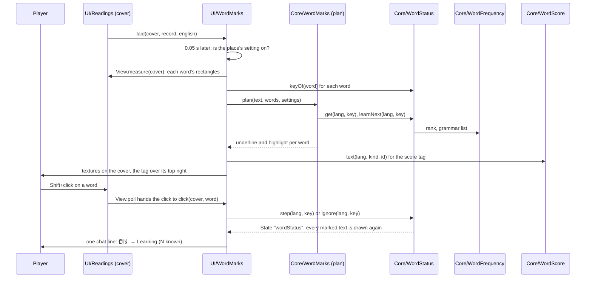

# Word status

> What the player knows of each word of the game's text, shown where they read: an underline under the words not known yet, a soft highlight on the words worth stopping for, and a tag that says how much of a text the player knows. Code: `Core/WordFrequency.lua` (how often each word is used), `Core/WordStatus.lua` (keys, statuses, the words to learn next, the saved table), `Core/WordScore.lua` (the scores), `Core/WordMarks.lua` (which word takes which mark), `Core/WordImport.lua` (the paste and the export), `UI/WordMarks.lua` (the marks on word-card covers, the score tag, the two clicks, the card's status line), `UI/ChatMarks.lua` (the marks on chat lines; load step `chatmarks`), `UI/KnownWordsWindow.lua` (the known words window), the `marks.*` settings in `Core/Settings.lua`, the Word status section of the Words page in `UI/Options.lua`, the strings in `UI/OptionsText.lua`, `/wfj known` in `UI/Slash.lua`, the `wordstatus` and `wordstatus.sync` load steps in `Main.lua`; in the pipeline `wfj/core/frequency.py`, `pipeline/grammar_words.txt` and the frequency step of `wfj/cmd/generate.py`. Decision: [ADR-111](../adr/111-word-status-marks-frequency-and-score.md).

## Purpose
A learner reading a quest cannot see at a glance which words of a line they know, which ones are worth learning next, or how much of the text they understand. Every word of the game's Japanese (and, in English first, every English word that has a card) gets a status the player controls: Unknown, Learning, Known or Ignored. The reading surfaces show it: a red line under an Unknown word, a blue line under a Learning word, a soft green highlight behind the Unknown words worth learning next, and a small tag with the share of the text the player knows. Saving a word and studying it move its status by itself, and a pasted word list marks thousands of words at once. A player who turns the marks off sees nothing new.

## How it works


### The word key
A Japanese word is its dictionary form, a tab, and that form's reading: `倒す<TAB>たおす`. The form comes from the word's meaning (its `lemma` and `lemmaReading`); a word with no dictionary form is itself with its reading. So 倒して and 倒した share 倒す's status on every line, and two words written alike but read differently are two words. A name (`word.name`) and a class or race word the addon fills in take no key and no mark.

An English word (in English first) is its lower-cased form, by the rule English word cards use: a word with a row in the English frequency list is itself; else a contraction is its first word (`you're` is `you`); else a plural with no row of its own is its singular when that has four letters or more (`golds` is `gold`). Japanese and English statuses are kept apart.

### Statuses and the defaults
| status | underline | counted in the score |
|---|---|---|
| Unknown | red | yes, as not known |
| Learning | blue | yes, as not known |
| Known | none | yes, as known |
| Ignored | none | no |

With no status set by the player a word is Unknown, with two exceptions:

- a word on the grammar list (`Data/Freq/Grammar.lua`) is Ignored;
- a する verb whose noun is Known is Known (準備する is Known once 準備 is).

A status the player set always wins, an explicit Unknown included. An Unknown the player set is kept as theirs (`"u"`), as against a word nobody touched: a grammar word or a する verb of a Known noun set to Unknown stays Unknown, and so does a saved word, whatever its study card says later.

### Changing a status
While the mouse is on a word on a marked place (its place's setting on):

| click | what happens |
|---|---|
| Shift+click | Unknown → Learning → Known → Unknown; an Ignored word goes to Unknown |
| Shift+right-click | sets Ignored, or takes an Ignored word back to Unknown |

A click counts when it is pressed and released on the same word, read by polling the mouse as the save click is ([Word list → The save click](word-list.md)). The right button is polled by `UI/WordMarks.pollRight`, and a button already held when the mouse arrives is the end of a drag, not a click. One chat line says what changed, with the dictionary form, the new status in its colour and the number of Known words: `WFJ: 倒す → Learning (812 known)`. A Shift+click that changed a status is not also a save.

**The word card** of a word with a key gains, above the save hint, a status line: the status in its colour, `#` and the word's rank among the game's words, and **Common** in green when the word is one of the words to learn next. Under it a hint names the two clicks. All of it follows the language showing.

**When the save click is Shift+click** ([Settings](settings.md), `words.saveClick`), the status clicks are off, and the card's hint says so: pick another save click to set a status by click.

### The marks
The marks are textures on the word-card cover that `UI/Readings` already lays over the text, so they scroll and clip with it, and they are never made in combat on their own (a cover is only made out of combat). `UI/WordMarks` draws them 0.05 seconds after a cover is laid, once for any number of asks; again with the rectangles just measured when the mouse enters the cover; again when the cover is shown or changes size; and on every marked cover when a status changes, an import runs, a setting moves or word cards are switched (State events `wordStatus` and `wordMarks`). A cover that is detached loses its marks at once.

**The underline.** Red (Unknown) or blue (Learning), inset one unit at each end of the word's box. `WordMarks.gap` measures the smallest space between the bottom of one text line and the top of the line below, from the words' own boxes (a single line counts as room enough). The line is at least two screen pixels thick when that gap is at least 4 units and at least one pixel otherwise, set on the pixel grid with the client's `PixelUtil` so it draws the same thickness everywhere. It sits in the middle of the gap when the gap is at least the line's thickness, and straight under the word's box when the lines leave no gap, so it never covers the line below. `/wfj debug` lists each marked text with the gap it measured.

**The highlight.** A soft green box behind an Unknown word, never behind a Learning, Known or Ignored one. The setting `marks.highlight` picks which:

| choice | highlighted |
|---|---|
| Off | nothing |
| Common words (default) | each Unknown word that is one of the words to learn next |
| Common words that are the only new word | each such word that is also the only Unknown word of its sentence |
| The only new word in a sentence | each word that is the only Unknown word of its sentence |

Sentences are cut after 。！？!? and at a line break; an English text after a full stop too.

**The words to learn next** are the 300 most used words of the game (`Core/WordFrequency`'s order) whose status is Unknown (`WordStatus.LEARN_NEXT`). The set is worked out again after any change, so marking one of them Learning, Known or Ignored lets the next one in.

**Where marks never show:** while English is showing in Japanese first (the reveal key), with translation off, with word cards off (`readings.enabled`), on a name, on a class or race word, on a live tooltip, a button, a tab, a menu, the HUD or a plain window label. They live on the cover, so they show only where a word card would.

### The places and their settings
Each place has its own switch. With a place off, no mark, no score tag, no status line on the card and no status click there.

| setting | default | surfaces |
|---|---|---|
| `marks.quest` | on | the quest window's offer, progress, turn-in and greeting text, the quest log's details and its popup, NPC talk; Dialogue UI's quest, greeting and talk text. A window's own headings and labels, a widget that holds only a name, and a quest's title (a name) take word cards and never a mark |
| `marks.book` | on | book and letter pages, and Dialogue UI's book |
| `marks.voicepanel` | on | the voice panel's text |
| `marks.tooltip` | on | the frozen tooltip |
| `marks.chat` | off | chat lines (see [Chat](#chat)) and the chat word card |

Five more settings shape the marks everywhere: `marks.enabled` (on; off switches the whole feature off: no mark, no tag, no status line on the word card and no status click, while the statuses themselves are kept), `marks.underline` (on, the underline under Unknown words), `marks.learning` (on, the underline under Learning words), `marks.highlight` (Common words) and `marks.score` (on, the score tags). The Words page shows all ten in its **Word status** section, with the counts, the whole game's score and the **Known words** button ([Settings → Settings pages](settings.md#settings-pages)). A change redraws the marks at once.

**In the welcome tour.** After Study Japanese or Study English, the welcome window's tour has a word status page: the Shift+click, the underline, the green highlight and the score tag, and `/wfj known` ([Settings → Welcome window](settings.md#welcome-window)). Just play turns word cards off, so it shows no marks and its tour has no such page.

### The comprehension score
A text's score is known words over counted words, as a whole percent rounded down, so a text with a word still unknown never reads as 100. An Ignored word is in neither; a Learning word counts as not known; a name, a class or race word and a word with no card are not words here.

**The score tag** sits over the top right corner of the text: `Known 84%` (`理解度 84%`), red under 60%, yellow from 60%, green from 80%, purple from 95%. It shows on:

- a quest's description, progress or turn-in text, scored as the whole quest (description, objectives, progress and turn-in together);
- an NPC talk line;
- a book or letter page.

It shows once per text: where a window lays a line out in several paragraphs, the first paragraph carries it. A text of fewer than 5 counted words takes none. `marks.score` off, or the place off, hides it. In English first the tag scores the line's English words.

**The whole game's score** weights every word by how often the game uses it (Ignored words left out), with one figure per kind of text: quests, NPC talk, books, windows, items, spells. The known words window and the Words page show it for the language being studied, the whole figure to one decimal place.

### The known words window
`UI/KnownWordsWindow` (`WFJKnownWordsWindow`, 580 × 530, from `/wfj known` or **Known words** on the Words page) is a tool window. It shows no game text, and every string of it is in one language at a time, following the direction and the reveal key.

- **Words in:** Japanese or English; it opens on the language being studied (English in English first).
- **Mark as:** Known or Ignored.
- **The box:** paste words here. **Import** marks them; **Export** fills the box with the player's statuses, selected for the player's own copy.
- **The last import's numbers:** how many were marked, already so, left as set by hand, and not in the game. They are saved, and shown again when the window opens.
- **The counts:** Known, Learning and Ignored among the game's words, of how many.
- **The scores:** the whole game's, and one per kind of text.

**What an import reads.** Words split by commas, spaces, tabs, new lines or Japanese punctuation (、。・「」（）and the rest). Furigana brackets (`食[た]べる`) and HTML tags are dropped, and so is everything not of the language: for Japanese every Latin letter and digit, for English everything but letters and apostrophes. Each piece is looked at once.

**The matching order** for a Japanese piece, the first that matches wins:

1. a dictionary form, in every reading the game has for it;
2. a form the game's text uses (the chat word list), taken to its dictionary form;
3. that, after a polite or past ending is removed (ました, ません, ない, たい, て, た and the rest, longest first);
4. when the piece is all kana, the reading of exactly one dictionary form. A kana piece that is the reading of several is not matched.

An English piece matches its key in the English frequency list. A line that is `word<TAB>reading` of one game word (a two-column list) is that word exactly. A line whose last column names a status (`known`, `learning`, `ignored`, `unknown`) is an exported line: it sets that word to that status as it is, whatever the word (a chat word has no row of the frequency list) and whatever status the word had. Any other word that already has a status keeps it.

A word the player already set by hand to something else keeps its status and is counted as left. After the import the box holds the pieces the game's text does not use, under "Not found in the game's text". An import announces its changes once, at the end.

**The export** is one line per word the player set a status on, sorted: `word<TAB>reading<TAB>status` (English: `word<TAB>status`). Pasted into the import, each line sets that word to that status, so a list moves between machines.

### Automatic status
`Status.sync` runs at load and whenever the word list or a study card changes (State events `words` and `studied`):

- a saved word with no status becomes Learning;
- a word whose study card is stable for 21 days or more (`WordStatus.KNOWN_AT`, the card's stability read, never written) becomes Known, unless the player set it Ignored or Unknown.

Nothing ever moves a status down. The saved entry's key is its dictionary form and reading (its `lemma` and `lemmaReading`), or the word and its reading; an English entry its English key. See [Word list](word-list.md) and [Study](study.md).

### English first
In English first the same statuses, clicks, marks, highlight choices, scores and import work on English words, against the English frequency list and in a list of their own. Marks show where English word cards show (the client's quest, NPC talk and book windows) and on chat. Dialogue UI's windows, the voice panel and the frozen tooltip have no English word cards, so they take no English marks.

### Chat
With `marks.chat` on, `UI/ChatMarks` looks at the visible chat lines every 0.25 seconds, only while translation is on, word cards are on and the direction's own language shows (not while the reveal key is held). Nothing is hooked and no chat line is changed. Each line that shows new text gets an overlay of its own, the size of the line, and `Core/ChatWords` finds its words (Japanese in Japanese first, English in English first), placed through `View.chatSpanAreas` ([Chat tools](chat-tools.md)). The overlay takes the same plan and the same textures as a cover. An overlay is drawn again when its line's text changes or a status changes, and taken down when its line leaves the screen.

A line that has faded out, a line whose text the client keeps secret, a link's label and an escape sequence take no marks. Chat lines take no score tag. The chat word card (`UI/ChatCards`) takes the status line and the status clicks while `marks.chat` is on.

### Persistence
`WFJ_Known`, account-wide, never shipped. `Main.lua` loads it in the `wordstatus` step; a load that fails keeps the saved table, so the client never writes an empty one over it.

```lua
WFJ_Known = {
  schema = 1,
  ja = { ["倒す\tたおす"] = "k" },        -- "k" known, "l" learning, "i" ignored, "u" unknown
  en = { ["kill"] = "l" },
  lastImport = { ja = { marked = 0, already = 0, kept = 0, missing = 0 }, en = { … } },
}
```

- `"u"` is an Unknown the player set, as against a word with no entry, which nobody touched.
- At load an entry whose key is not a string or whose code is not one of the four is dropped, and so is any field but `schema`, `ja`, `en` and `lastImport`.
- **A table saved by a newer version of the addon** (a higher `schema`) is kept exactly as it is and never written: every word reads as its default, a status click prints that the statuses cannot be changed here, and an import and the automatic moves do nothing.

### The frequency data
`make generate` builds the frequency lists from the shipped readings ([Pipeline → Generate + validate](pipeline.md#generate--validate)):

- **`Data/Freq/Freq_ja_NN.lua`** (4 files, `WFJ.Data.freqJa`): every distinct Japanese word key of the shipped reading rows, `["dictionary form<TAB>reading"] = "q,g,b,u,i,s"`: how many times it is used in quest, NPC talk, book, window, item and spell text. A line shipped under two keys (a female variant, a repeated quest's text) is counted once. Today: 30,495 words, 787,821 uses.
- **`Data/Freq/Freq_en_NN.lua`** (2 files, `WFJ.Data.freqEn`): every English word of the shipped English word card rows and of the common word list, `["word"] = "q,g,b,u,i,s"`: how many lines of each kind list it.
- **`Data/Freq/Grammar.lua`** (`WFJ.Data.grammar`, `[key] = "1"`): the grammar list, from `pipeline/grammar_words.txt`.

A word's file is the CRC-32 of its key modulo the file count. The files hold counts, never ranks: `Core/WordFrequency` sorts each list once (most used first, equal totals by key), so a new word changes one file. The frequency files total about 2.1 MB; a test fails above 3 MB.

**The grammar list** (`pipeline/grammar_words.txt`, 94 words, `word<TAB>reading` a line, `#` starts a comment) holds sentence endings, particles and set grammar patterns the readings list as words (だろう, について, ことができる, から, が). They start as Ignored, so they take no mark and are left out of the score until the player gives one a status. Content words never belong there: an adverb, a pronoun or a conjunction is vocabulary. `generate` (and so `validate`) refuses a line that is not `word<TAB>reading`, a word that is not a word of the Japanese frequency list, and a word listed twice.

### The window test
The window test's `marks` part runs after `chat` and before `bagclick` ([Testing → Window test](../testing/strategy.md)). It opens the known words window with `/wfj known`, reads its text and hides it again (a window the player had open is left open). Then it looks at every frame carrying marks: the word-card covers and the chat overlays, wherever the run left them. It fails on:

- English left in the known words window while Japanese shows;
- marks showing on a frame whose text is gone;
- a score tag that is not a percent.

It clicks nothing and imports nothing. A run with no marked text on screen is not a fault. Another addon cannot ask the addon's plan, so the test cannot check which word takes which mark; the Lua specs hold that.

## Key files
- `addon/WoWForeverJapanese/Core/WordFrequency.lua`: `count`, `rank`, `at`, `uses`, `grammar`, `forms`, `read`; `KINDS` (pure)
- `addon/WoWForeverJapanese/Core/WordStatus.lua`: `load`, `keyOf`, `englishKey`, `get`, `own`, `entries`, `set`, `step`, `ignore`, `learnNext`, `counts`, `sync`, `batch`, `version`, `readonly`, `noteImport`, `lastImport`; `LEARN_NEXT`, `KNOWN_AT` (pure)
- `addon/WoWForeverJapanese/Core/WordScore.lua`: `line`, `text`, `game`, `percent` (pure)
- `addon/WoWForeverJapanese/Core/WordMarks.lua`: `sentences`, `plan` (pure; `WFJ.WordMarksPlan`)
- `addon/WoWForeverJapanese/Core/WordImport.lua`: `match`, `apply`, `export` (pure)
- `addon/WoWForeverJapanese/UI/WordMarks.lua`: `PLACE`, `active`, `gap`, `line`, `paint`, `laid`, `clear`, `entered`, `moved`, `redraw`, `report`, `statusLine`, `click`, `pollRight`, `arrived`
- `addon/WoWForeverJapanese/UI/ChatMarks.lua`: `words`, `look`, `init`; `EVERY`
- `addon/WoWForeverJapanese/UI/KnownWordsWindow.lua`: `open`, `import`, `export`, `studied`, `countsText`, `scoreText`
- `addon/WoWForeverJapanese/UI/Readings.lua`: `View.measure`, `View.poll` (the status clicks), the calls into `UI/WordMarks` in `lay`, `View.detach`, `onEnter`, `showHover` and `View.setEnabled`
- `addon/WoWForeverJapanese/Core/Readings.lua`: `Readings.englishWords` (an English line's words, for its score)
- `addon/WoWForeverJapanese/Core/Study.lua`: `Study.answer` fires `studied`
- `addon/WoWForeverJapanese/Core/Data.lua`: the `freqJa`, `freqEn` and `grammar` kinds
- `addon/WoWForeverJapanese/Core/Settings.lua`, `UI/Options.lua`, `UI/OptionsText.lua`, `UI/Slash.lua`, `Main.lua`; `WoWForeverJapanese.toc`: `WFJ_Known` in `## SavedVariables`
- `pipeline/wfj/core/frequency.py`: `key_of`, `japanese_counts`, `english_counts`, `ranked`, `rows`, `shards`, `load_grammar`
- `pipeline/wfj/cmd/generate.py` (`_plan_frequency`), `pipeline/wfj/emit/schema.py` (`FREQ_GRAMMAR`, `freq_relpath`)
- `pipeline/grammar_words.txt`
- `pipeline/wfj/dev/client_surface.py`: `WFJScanMarksRead`, `read_marks`, `marks_problems`
- `tests/lua/spec/word_frequency_spec.lua`, `word_status_spec.lua`, `word_score_spec.lua`, `word_marks_spec.lua`, `word_marks_view_spec.lua`, `word_import_spec.lua`, `chat_marks_spec.lua`, `known_words_window_spec.lua`; `tests/python/test_frequency.py`

## Invariants
- A word's status is keyed by its dictionary form and that form's reading (English: its lower-cased key), never by the line or the form as written.
- A name, a class or race word and a word with no card take no key, no mark and no place in the score. [Principle 2](../architecture/principles.md#2-names-stay-in-english).
- Marks are textures on the existing covers and on overlays of the addon's own. Nothing hooks a Blizzard frame, no chat line is changed, and no mark is ever drawn while English is showing in Japanese first. [Principle 3](../architecture/principles.md#3-japanese-by-default-english-one-key-away).
- Every word's place on screen comes from the one guarded span call in `UI/Readings` (`View.spanAreas`, or `View.chatSpanAreas` for a chat line).
- Nothing moves a status down on its own: saving and studying only move a word up, and an import never changes a status the player set by hand.
- `WFJ_Known` is the player's own, never shipped, and a table saved by a newer version is never written.
- The frequency lists ship counts of single words, never a line of the game's text or words in a line's order ([Principle 4](../architecture/principles.md#4-the-addon-never-ships-stored-english)). They are an index of the shipped readings, which keep their own provenance.

## Edge cases
- **A する verb**: Known while its noun is Known and the player set no status on the verb itself.
- **The save click is Shift+click**: the status clicks are off and the card says so; Shift+click saves as before.
- **A kana word with several dictionary forms** (かえる is 帰る and 変える): an import leaves it in the box; the player pastes the kanji form or a `word<TAB>reading` line.
- **A pasted word the game never uses**: left in the box, counted as not in the game.
- **A quest split over several paragraphs**: one tag, on the first, for the whole quest.
- **A short text** (fewer than 5 counted words, or all Ignored): no tag.
- **Statuses saved by a newer version**: kept as they are; this version shows the defaults and changes nothing.
- **A word saved twice, or studied again**: the status only ever moves up.
- **A chat line that fades out or scrolls away**: its overlay is taken down at the next look.

## Related
- [Readings](readings.md) · [Word list](word-list.md) · [Study](study.md) · [Chat tools](chat-tools.md) · [Settings](settings.md) · [Pipeline](pipeline.md) · [ADR-111](../adr/111-word-status-marks-frequency-and-score.md) · [ADR-081](../adr/081-english-first-and-english-word-cards.md) · [Architecture → Addon modules](../architecture/addon-modules.md) · [Data model](../architecture/data-model.md) · [Glossary](../glossary.md)
